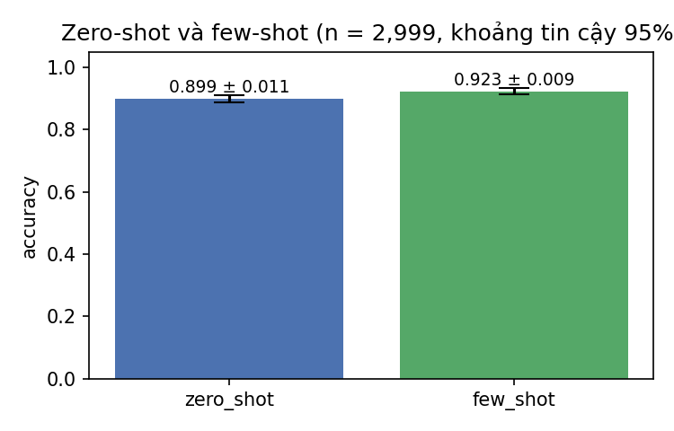
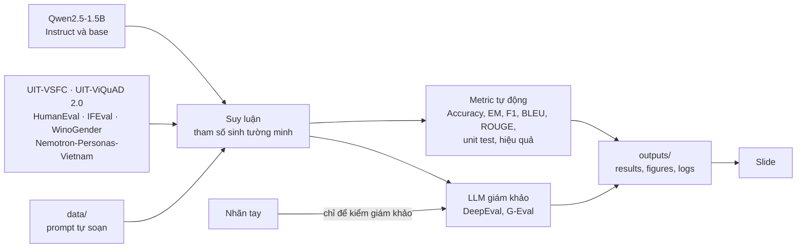

<div align="center">

# Tìm hiểu mô hình ngôn ngữ lớn (LLMs)

**Từ token đầu vào đến câu trả lời: 10 chủ đề về LLM, mỗi chủ đề có demo chạy trên model thật**


[Slide (PDF)](slides/infographic/llm_slides.pdf) ·
[Notebook](notebook/llm_presentation.ipynb) ·
[Kết quả](outputs/results) ·
[Sổ thí nghiệm](docs/experiments/experiment_log.md) ·
[Tài liệu tham khảo](docs/references.md)

</div>

## Mục lục

- [Giới thiệu](#giới-thiệu)
- [Kết quả chính](#kết-quả-chính)
- [Nội dung 10 mục](#nội-dung-10-mục)
- [Quy trình](#quy-trình)
- [Bắt đầu nhanh](#bắt-đầu-nhanh)
- [Cấu hình giám khảo LLM](#cấu-hình-giám-khảo-llm)
- [Model và dữ liệu](#model-và-dữ-liệu)
- [Phương pháp đánh giá](#phương-pháp-đánh-giá)
- [Tái lập kết quả](#tái-lập-kết-quả)
- [Hạn chế](#hạn-chế)
- [Cấu trúc thư mục](#cấu-trúc-thư-mục)
- [Sản phẩm nộp](#sản-phẩm-nộp)
- [Thành viên](#thành-viên)
- [Giấy phép và ghi nhận](#giấy-phép-và-ghi-nhận)

## Giới thiệu

Bài thuyết trình nhóm môn **Học sâu**, Trường Đại học Giao thông vận tải TP.HCM (UTH). Bài trả lời ba câu hỏi:

1. LLM **học và sinh văn bản** như thế nào?
2. LLM đi qua **những giai đoạn huấn luyện** nào (pretraining, SFT, preference alignment)?
3. LLM **làm được gì**, và **hạn chế ở đâu**?

Toàn bộ demo nằm trong **một notebook**, chạy trên [Qwen2.5-1.5B-Instruct](https://huggingface.co/Qwen/Qwen2.5-1.5B-Instruct) (decoder-only, 1,543,714,304 tham số). Dữ liệu gồm UIT-VSFC và UIT-ViQuAD 2.0 cho tiếng Việt, cùng các bộ chuẩn HumanEval và IFEval.

**Phạm vi:** notebook chỉ suy luận, không huấn luyện và không fine-tune. Kết luận áp dụng cho một model 1.5B trên các bộ dữ liệu đã nêu.

## Kết quả chính

Lần chạy chính thức: `20261129_003355_normal` (Kaggle GPU T4 x2, float16, seed 42, 41.3 phút).

| Thí nghiệm | Metric | So sánh | Kết quả | n |
|---|---|---|---|---:|
| Phân loại cảm xúc, UIT-VSFC | Accuracy | zero-shot → few-shot | **89.86% → 92.30%** (McNemar exact, p = 1.5e-08) | 2,999 |
| Làm theo chỉ dẫn, IFEval | Accuracy, prompt-level strict | base → Instruct | **0.25 → 0.40** | 100 |
| Sinh mã, HumanEval | Pass@1 (greedy) | – | **0.561** (92/164) | 164 |
| Hỏi đáp có đáp án, UIT-ViQuAD 2.0 | Token F1 | không RAG → có RAG | **0.007 → 0.395** | 15 |
| | Exact Match | không RAG → có RAG | 0.00 → 0.20 | 15 |
| Hỏi không tài liệu | G-Eval Correctness | hai cách hỏi | 0.20 / 0.24 | 15 |
| Thực thể không tồn tại | G-Eval False premise | hai cách hỏi | 0.00 / 0.05 | 3 |
| Thiên lệch giới tính theo nghề | Pearson r | tiếng Anh / tiếng Việt | 0.69 / 0.44 | 60 / 122 nghề |
| Hiệu quả trên T4 | TTFT · throughput · VRAM đỉnh | – | 0.046 s · ≈ 25 token/s · ≈ 2.9 GiB | 3 prompt |

<div align="center">

</div>

> Các thí nghiệm n = 3 và n = 15 chỉ để minh họa. Thí nghiệm có kiểm định thống kê so sánh hai cách là zero-shot và few-shot (n = 2,999). Đọc kèm mục [Hạn chế](#hạn-chế).

## Nội dung 10 mục

| # | Chủ đề | Demo trên model thật | Slide |
|:---:|---|---|:---:|
| 1 | Language model, LLM, chatbot | Một model, bốn tác vụ: hỏi đáp, tóm tắt, dịch, sinh mã | 3–4 |
| 2 | Transformer, decoder-only, causal attention | Causal mask, attention thật, top-5 token tiếp theo | 5–7 |
| 3 | Tokenization, token ID, embedding | Một câu Việt và một câu Anh, Qwen so với GPT-2 | 8–9 |
| 4 | Next-token prediction, cross-entropy | Cặp ngữ cảnh → token mục tiêu, loss từng token | 10 |
| 5 | Pretraining, SFT, RLHF / DPO | Bản base và Instruct trên cùng prompt, IFEval | 11–12 |
| 6 | Greedy, temperature, top-p | Cùng một prompt, 5 cấu hình sinh | 13–14 |
| 7 | In-context learning | Zero-shot và few-shot trên cùng tập test | 15 |
| 8 | Prompting, fine-tuning, RAG | Cùng câu hỏi, không RAG và có RAG (TF-IDF top-3) | 16–17 |
| 9 | Hallucination, thiên lệch, giới hạn ngữ cảnh | Một câu trả lời sai và cách kiểm chứng | 18–19 |
| 10 | Thử nghiệm có kiểm soát, kết luận | McNemar, bộ 18 metric, phân tích lỗi | 20–24 |

Lý thuyết và ghi chú từng mục: [docs/research/](docs/research). Một số file ở đó còn số của lần chạy cũ; số chính thức nằm ở [outputs/results/](outputs/results).

## Quy trình



## Bắt đầu nhanh

### Yêu cầu

- Tài khoản Kaggle đã **xác minh số điện thoại** (để bật GPU và Internet).
- Accelerator **GPU T4 x2**, **Internet: On** trong suốt lần chạy.
- API key cho LLM giám khảo, hoặc dùng giám khảo local (xem [cấu hình](#cấu-hình-giám-khảo-llm)).
- Không cần token Hugging Face: các model và dữ liệu đều công khai.

### Chạy trên Kaggle (khuyến nghị)

1. **File → Import Notebook**, chọn [notebook/llm_presentation.ipynb](notebook/llm_presentation.ipynb).
2. Tạo một Kaggle Dataset gồm 3 file trong [data/](data), rồi gắn vào notebook: `tasks_prompts.json`, `base_vs_instruct.json`, `human_labels_v2.json`.
3. **Add-ons → Secrets**: tạo secret tên đúng `JUDGE_API_KEY` và bật Attach.
4. **Chạy thử:** cell 0.1 đặt `SMOKE = True` → Run All. Mất khoảng 10 phút, kết quả ghi vào `outputs/_smoke/`.
5. **Chạy chính thức:** đặt `SMOKE = False` → **Restart session** → **Save Version → Save & Run All**.

Restart session trước khi chạy chính thức để model của lần chạy trước không còn trên GPU; nếu còn, số VRAM sẽ sai.

### Chạy trên máy cá nhân

```bash
git clone https://github.com/pptthu/LLMs_DL.git
cd LLMs_DL
pip install -r requirements.txt
pip install notebook
jupyter notebook notebook/llm_presentation.ipynb
```

Cần GPU CUDA. Nhóm chưa chạy trọn notebook ngoài Kaggle. `lm-eval` và các gói đi kèm không có trong `requirements.txt`; cell 5.5 tự cài khi chạy.

> [!WARNING]
> Mục 1 **thực thi mã do model sinh ra**, gồm 164 bài HumanEval chạy trong tiến trình con có giới hạn thời gian. Đây không phải sandbox. Chỉ chạy trên môi trường cô lập như Kaggle.

### Thư viện chính

| Thư viện | Phiên bản đã chạy | Vai trò |
|---|---|---|
| `torch` | 2.11.0+cu130 | Chạy model trên GPU |
| `transformers` | 5.20.2 | Tải model, tokenizer, `generate()` |
| `accelerate` | 1.15.0 | Đặt model lên GPU |
| `pandas` / `pyarrow` | 2.3.3 / 23.0.1 | Đọc Parquet, ghi CSV |
| `scikit-learn` | 1.6.1 | TF-IDF, accuracy, confusion matrix |
| `statsmodels` | 0.15.0 | Kiểm định McNemar |
| `scipy` | theo Kaggle | Tương quan Pearson |
| `matplotlib` | 3.10.0 | Vẽ hình |
| `lm-eval` | 0.4.13 | Hàm chấm IFEval |
| `deepeval` | 4.3.5 | Metric dùng LLM giám khảo |
| `sacrebleu` / `rouge-score` | 2.6.0 / theo pip | BLEU / ROUGE |

Môi trường đầy đủ của lần chạy: [outputs/results/env.json](outputs/results/env.json).

## Cấu hình giám khảo LLM

Đặt ở cell 10.3c của notebook:

| `JUDGE_BACKEND` | Giám khảo | Cần gì | Số lần chấm G-Eval |
|---|---|---|:---:|
| `"api"` (bài dùng) | `gpt-6.2-sol` qua API tương thích OpenAI | Secret `JUDGE_API_KEY`, trả phí | 20 |
| `"local"` | Qwen2.5-7B-Instruct 4-bit | GPU thứ hai, miễn phí | 1 |

> [!IMPORTANT]
> Giữ `JUDGE_API_KEY = ""` trong cell và chỉ đặt key trong Kaggle Secrets. Không commit key. Chế độ `api` gửi câu hỏi, output và đoạn tài liệu tới một dịch vụ trung gian bên thứ ba; nhóm không kiểm chứng được model thật phía sau dịch vụ này.

## Model và dữ liệu

| Tài nguyên | Dùng ở | Giấy phép |
|---|---|---|
| [Qwen2.5-1.5B-Instruct](https://huggingface.co/Qwen/Qwen2.5-1.5B-Instruct) | Model chính | Apache-2.0 |
| [Qwen2.5-1.5B](https://huggingface.co/Qwen/Qwen2.5-1.5B) (base) | Mục 5 | Apache-2.0 |
| [GPT-2](https://huggingface.co/openai-community/gpt2) (chỉ tokenizer) | Mục 3 | MIT |
| [Qwen2.5-7B-Instruct](https://huggingface.co/Qwen/Qwen2.5-7B-Instruct) | Giám khảo local | Apache-2.0 |
| [UIT-VSFC](https://huggingface.co/datasets/uitnlp/vietnamese_students_feedback) | Mục 7, 10 | Ghi "unknown" |
| [UIT-ViQuAD 2.0](https://huggingface.co/datasets/taidng/UIT-ViQuAD2.0) | Mục 8, 9 | Không ghi |
| [HumanEval](https://huggingface.co/datasets/openai/openai_humaneval) | Mục 1 | MIT |
| [IFEval](https://huggingface.co/datasets/google/IFEval) | Mục 5 | Apache-2.0 |
| [WinoGender](https://github.com/rudinger/winogender-schemas) | Mục 9 | MIT |
| [Nemotron-Personas-Vietnam](https://huggingface.co/datasets/nvidia/Nemotron-Personas-Vietnam) | Mục 9 | CC BY 4.0 |

Notebook tự tải model và dữ liệu; repo không chứa trọng số hay bộ dữ liệu gốc. Mỗi model Qwen 1.5B nặng khoảng 3.1 GB. Mô tả chi tiết: [docs/models/](docs/models).

## Phương pháp đánh giá

**Bộ 18 metric đánh giá LLM:**

| Nhóm | Metric |
|---|---|
| Dự đoán ngôn ngữ (2) | Cross-Entropy, Perplexity |
| Độ đúng, trùng khớp (5) | Accuracy, Exact Match, Token F1, BLEU, ROUGE |
| Ngữ nghĩa, LLM giám khảo (4) | Answer Relevancy, Faithfulness, Hallucination, G-Eval |
| Sinh mã (2) | Unit-test pass rate, Pass@k |
| Hiệu quả thực thi (5) | TTFT, Latency, Throughput, Memory, Cost / request |

**Bổ sung ngoài bộ:** khoảng tin cậy 95%, confusion matrix, McNemar, Pearson r (WinoGender), DeepEval Bias, top-5, distinct-n.

**Nhãn tay** ([data/human_labels_v2.json](data/human_labels_v2.json)) chỉ dùng để kiểm giám khảo, không phải metric kết quả. Tỉ lệ khớp từng metric: [judge_vs_human.csv](outputs/results/judge_vs_human.csv).

## Tái lập kết quả

- **Sinh văn bản:** tham số luôn truyền tường minh. Phần đánh giá dùng greedy; demo lấy mẫu ở mục 6 cố định seed (42, 43, 44).
- **Phiên bản:** `lm-eval` và `deepeval` được ghim. Revision của model và dữ liệu được ghi trong log nhưng chưa ghim trong code; nguồn cập nhật thì kết quả có thể đổi.
- **Độ ổn định đã đo:** hai lần chạy `20261128_232631` và `20261129_003355` cho output model trùng nhau ở mọi file đã so. Điểm giám khảo thì dao động: DeepEval (chấm 1 lần) đổi kết luận đạt / không ở 26/130 lần chấm, G-Eval (trung bình 20 lần) ở 7/201.
- **Log:** mỗi lần chạy có một thư mục `outputs/logs/<YYYYMMDD_HHMMSS>_<loại>/`, tóm tắt ở [experiment_log.md](docs/experiments/experiment_log.md).
- **Ngoại lệ:** `judge_vs_human*.csv` và hình thẻ E13 được tính lại trên máy từ kết quả của lần chạy chính thức với nhãn tay v2 (`outputs/logs/20261129_021918_local/`). Vì vậy output in sẵn ở cell 10.3e và các bảng, thẻ dùng nó trong notebook vẫn theo nhãn v1.

## Hạn chế

- **Phạm vi hẹp:** một model 1.5B, một bộ ví dụ few-shot, mỗi thí nghiệm một cấu hình seed. Không suy rộng sang LLM nói chung.
- **Mẫu nhỏ:** nhiều thí nghiệm ở mục 1, 8, 9 chỉ có 1–18 câu; BLEU và ROUGE tính trên 1 câu.
- **Nhãn tay v2:** một người gắn, luật chốt sau khi đã xem điểm giám khảo nên không mù với kết quả; AI sửa 2/192 ô theo yêu cầu. Semantic equivalence và Completeness khớp giám khảo 36/36 và hai cột nhãn trùng nhau, nên cần người gắn thứ hai kiểm lại.
- **So sánh hai giám khảo:** chỉ trên tối đa 36 output. Điểm từng câu của giám khảo Qwen lấy từ lịch sử git, số khớp tính bằng script ngoài notebook.
- **IFEval:** 100/541 prompt, tối đa 1,024 token; bản base bị cắt 47/100 và có 10 output rỗng.
- **Thiên lệch tiếng Việt:** tỉ lệ nữ theo nghề lấy từ dữ liệu tổng hợp, câu đo do nhóm soạn.
- **Dữ liệu:** có nhãn sai trong bộ gốc, ví dụ đáp án "1640" của một câu UIT-ViQuAD 2.0.

## Cấu trúc thư mục

```text
LLMs_DL/
├── notebook/
│   ├── llm_presentation.ipynb      # Notebook chính (bản nộp)
│   └── llm_extension_part02.ipynb  # Mở rộng mục 2, không thuộc bản nộp
├── data/                           # Prompt tự soạn, nhãn tay
├── outputs/
│   ├── results/                    # CSV, JSON của lần chạy chính thức
│   ├── figures/                    # Hình PNG
│   └── logs/                       # Log từng lần chạy
├── slides/
│   └── infographic/                # Deck 25 slide: HTML, PDF, PPTX, PNG
├── docs/
│   ├── research/                   # Lý thuyết, ghi chú từng mục
│   ├── experiments/                # Sổ thí nghiệm, phân tích lỗi
│   ├── models/                     # Model card
│   ├── rules/, templates/          # Quy tắc làm việc, khuôn tài liệu
│   └── references.md               # Tài liệu tham khảo
├── AI_usage.md                     # Khai báo sử dụng AI
├── CONTRIBUTING.md                 # Quy ước đóng góp
├── progress_status.md              # Nhật ký tiến độ
└── requirements.txt
```

Bắt đầu đọc tài liệu từ [docs/00_README_v4.md](docs/00_README_v4.md).

## Sản phẩm nộp

| Sản phẩm | Đường dẫn |
|---|---|
| Slide | [PDF](slides/infographic/llm_slides.pdf) · [PPTX](slides/infographic/llm_slides.pptx) |
| Notebook và hướng dẫn chạy | [llm_presentation.ipynb](notebook/llm_presentation.ipynb) · [Bắt đầu nhanh](#bắt-đầu-nhanh) |
| Bộ câu thử nghiệm | [data/](data) |
| Kết quả | [outputs/results/](outputs/results) · [outputs/figures/](outputs/figures) |
| Phân tích lỗi | [error_analysis_v2.md](docs/experiments/error_analysis_v2.md) |
| Tài liệu tham khảo | [references.md](docs/references.md) |

## Thành viên

| Họ và tên | Ngành / chuyên ngành | Nhóm |
|---|---|:---:|
| Phạm Phương Thanh Thư | Data Science & AI | 1 |
| Nguyễn Khánh Toàn | Data Science & AI | 1 |
| Ngô Hồng Phúc | Smart logistics | 1 |
| Phạm Thị Muội | Data Science & AI | 1 |
| Nguyễn Thái Bảo | Smart logistics | 1 |
| Nguyễn Bảo Đại | Data Science & AI | 1 |

Trình bày 10 mục và viết code notebook: Toàn. Phụ trách README: Muội. Quy ước đóng góp: [CONTRIBUTING.md](CONTRIBUTING.md). Nhóm có dùng công cụ AI; khai báo ở [AI_usage.md](AI_usage.md).

## Giấy phép và ghi nhận

Repo phục vụ học tập và **chưa có file giấy phép**. Model, dữ liệu và thư viện thuộc về tác giả tương ứng, theo giấy phép nêu ở [Model và dữ liệu](#model-và-dữ-liệu). Với UIT-VSFC và UIT-ViQuAD 2.0, nguồn tải không nêu giấy phép rõ ràng, nên repo không phân phối lại bộ dữ liệu; một số câu dùng để thử nghiệm có trong `outputs/` và `data/`.

Nhóm ghi nhận Qwen Team, nhóm UIT NLP, OpenAI (HumanEval), Google (IFEval), Rudinger và cộng sự (WinoGender), NVIDIA (Nemotron-Personas-Vietnam), EleutherAI (lm-evaluation-harness) và Confident AI (DeepEval). Danh sách trích dẫn đầy đủ: [docs/references.md](docs/references.md).
