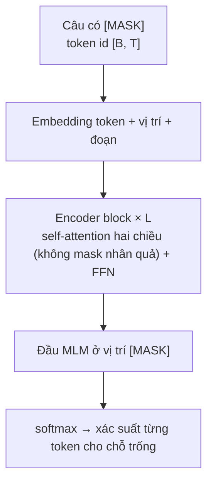

# Model card — mBERT (bert-base-multilingual-cased)  (v1)
- Toàn (AI hỗ trợ), 2026-11-16T02:10:00+07:00 | Ngày tra nguồn: 2026-11-16 | Trạng thái: **Duyệt: Toàn, 2026-11-16**
- Khuôn: `templates/MODEL_CARD_TEMPLATE_v2.md`.

## Purpose
Chỉ dùng ở phần 2 (demo so sánh, slide 6b): cho thấy encoder-only **nhìn hai chiều** (điền chỗ trống `[MASK]`), khác Qwen decoder-only chỉ nhìn quá khứ.

## Thông tin model
- **Nguồn:** https://huggingface.co/google-bert/bert-base-multilingual-cased | **Giấy phép:** Apache-2.0 | **Cần token:** chưa kiểm (kỳ vọng không)
- **Kích thước:** trang model ghi khoảng 0.2B tham số, lưu F32.
- **Ngôn ngữ:** pretrain trên 104 ngôn ngữ có Wikipedia lớn nhất; danh sách trong `google-research/bert/multilingual.md` có tiếng Việt.
- **Kiến trúc:** Transformer encoder-only, attention hai chiều; pretrain bằng masked language model (Devlin et al. 2019). Số lớp, hidden, head: **[cần kiểm từ `config.json`]**.
- **Mask token:** `[MASK]`.

## Sơ đồ kiến trúc

- Khác Qwen: không có causal mask, mỗi token nhìn cả trái và phải; không sinh văn bản tự hồi quy.
- Bảng tham số từng thành phần: **[cần tính từ `config.json` khi code]**.

## Cách lấy
```python
from transformers import pipeline
unmasker = pipeline("fill-mask", model="google-bert/bert-base-multilingual-cased", device=0)
unmasker("Thủ đô của [MASK] là Hà Nội.", top_k=5)
```
**Chưa chạy thử.** Kiểm ở smoke run.

## Cách dùng trong bài
- **Phần:** 2, cell 2.5–2.6. **Kết quả:** `outputs/results/compare_bert_qwen.csv`.
- **Gotcha:** `[MASK]` chỉ đoán **một** token; chọn câu mẫu có đáp án là một token của tokenizer mBERT.

## Log ghi gì về model
- Tên + revision, số tham số đếm bằng code, top-5 token + xác suất mỗi câu (`templates/RUN_LOG_TEMPLATE_v2.md`).
