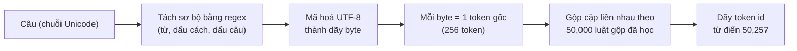

# Model card — GPT-2 tokenizer  (v2)
- Toàn (AI hỗ trợ), 2026-11-15 | Cập nhật: Toàn (AI hỗ trợ), 2026-11-16T01:40:17+07:00 | Ngày tra nguồn: 2026-11-15 | Trạng thái: **Duyệt: Toàn, 2026-11-16**
- Thay đổi so với v1: thêm sơ đồ kiến trúc mermaid theo `templates/MODEL_CARD_TEMPLATE_v2.md` (mẫu: `Lab-DL/labs/lab1/docs/models/mlp_baseline_v1.md`). Phần khác giữ nguyên. v1 giữ nguyên, không dùng.

## Purpose
Chỉ dùng ở mục 3, để so số token của câu tiếng Việt và tiếng Anh với tokenizer của Qwen2.5. **Chỉ tải tokenizer, không tải model.**

## Thông tin
- **Nguồn:** https://huggingface.co/openai-community/gpt2 | **Giấy phép:** MIT | **Cần token:** không (`gated: false`)
- **Loại:** byte-level BPE; từ điển 50,257 = 256 byte + 50,000 lần gộp + 1 token kết thúc văn bản (Hugging Face, *Summary of the tokenizers*).
- **File tokenizer:** `vocab.json`, `merges.txt`, `tokenizer.json`, `tokenizer_config.json`.
- Sơ đồ (byte-level BPE; từ điển theo Hugging Face *Summary of the tokenizers*, bước tách regex theo `encoder.py` của OpenAI GPT-2 **[Bổ sung, chưa mở kiểm lại]**):



- Được huấn luyện chủ yếu trên văn bản tiếng Anh → **có thể** tách tiếng Việt vụn hơn. Chưa đo; số thật lấy từ notebook phần 3.

## Cách lấy
```python
from transformers import AutoTokenizer
gpt2_tok = AutoTokenizer.from_pretrained("openai-community/gpt2")
```
Vài MB, chạy được trên CPU. **Chưa chạy thử.**

## Cách dùng trong bài
- **Mục / phần:** 3.
- **Đếm token:** `len(gpt2_tok(text, add_special_tokens=False)["input_ids"])`, cùng cách cho tokenizer Qwen để so công bằng.
- **Kết quả:** `outputs/results/token_counts.csv`.
