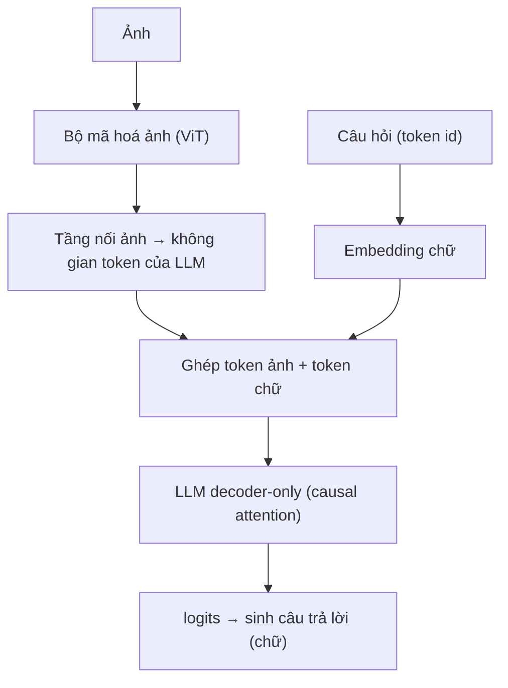

# Model card — Qwen2-VL-2B-Instruct  (v1)
- Toàn (AI hỗ trợ), 2026-11-16T02:10:00+07:00 | Ngày tra nguồn: 2026-11-16 | Trạng thái: **Duyệt: Toàn, 2026-11-16**
- Khuôn: `templates/MODEL_CARD_TEMPLATE_v2.md`.

## Purpose
Chỉ dùng ở phần 2 (demo so sánh, slide 6b): VLM nhận **ảnh + chữ**, so với Qwen2.5-1.5B-Instruct chỉ nhận chữ, trên cùng câu hỏi về một bức ảnh.

## Thông tin model
- **Nguồn:** https://huggingface.co/Qwen/Qwen2-VL-2B-Instruct | **Giấy phép:** Apache-2.0 | **Cần token:** chưa kiểm (kỳ vọng không)
- **Kích thước:** trang model ghi 2B tham số, lưu BF16.
- **Ngôn ngữ trong ảnh:** model card ghi hiểu được chữ nhiều ngôn ngữ trong ảnh, có tiếng Việt.
- **Vì sao không dùng Qwen2.5-VL-3B-Instruct:** trang model ghi khoảng 4B tham số, vượt luật "không dùng model lớn hơn 3B".
- **Yêu cầu:** `transformers` đủ mới; bản cũ báo `KeyError: 'qwen2_vl'`. Phiên bản tối thiểu: **[cần kiểm trên Kaggle]**.

## Sơ đồ kiến trúc  [cần đối chiếu báo cáo Qwen2-VL]

- Số tham số từng thành phần (ViT, tầng nối, LLM): **[cần lấy từ `config.json` / báo cáo khi code]**.

## Cách lấy
```python
from transformers import Qwen2VLForConditionalGeneration, AutoProcessor
vlm = Qwen2VLForConditionalGeneration.from_pretrained(
    "Qwen/Qwen2-VL-2B-Instruct", torch_dtype=torch.float16, device_map="auto")
processor = AutoProcessor.from_pretrained("Qwen/Qwen2-VL-2B-Instruct")
```
**Chưa chạy thử.** Giải phóng model eager (phần 2) trước khi nạp; in VRAM.

## Cách dùng trong bài
- **Phần:** 2, cell 2.7–2.8. **Input:** `data/vlm_image.png`, `data/compare_prompts.json`. **Kết quả:** `outputs/results/compare_vlm.csv`.
- **Tham số sinh:** `do_sample=False`, cùng `max_new_tokens` với Qwen2.5-1.5B-Instruct.

## Log ghi gì về model
- Tên + revision, dtype, số tham số đếm bằng code, VRAM trước/sau khi nạp, output từng câu (`templates/RUN_LOG_TEMPLATE_v2.md`).
