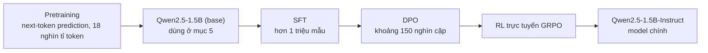

# Model card — Qwen2.5-1.5B (bản base)  (v2)
- Toàn (AI hỗ trợ), 2026-11-15 | Cập nhật: Toàn (AI hỗ trợ), 2026-11-16T01:40:17+07:00 | Ngày tra nguồn: 2026-11-14/15 | Trạng thái: **Duyệt: Toàn, 2026-11-16**
- Thay đổi so với v1: thêm sơ đồ kiến trúc mermaid theo `templates/MODEL_CARD_TEMPLATE_v2.md` (mẫu: `Lab-DL/labs/lab1/docs/models/mlp_baseline_v1.md`). Phần khác giữ nguyên. v1 giữ nguyên, không dùng.

## Purpose
Chỉ dùng ở mục 5, để so với `Qwen2.5-1.5B-Instruct`: cùng kiến trúc, cùng số tham số, khác giai đoạn huấn luyện.

## Thông tin model
- **Nguồn:** https://huggingface.co/Qwen/Qwen2.5-1.5B | **Giấy phép:** Apache-2.0 | **Cần token:** không (`gated: false`)
- **Kiến trúc và thông số:** giống bản Instruct (xem sơ đồ và bảng tham số trong `qwen2.5-1.5b-instruct_v2.md`).
- **Giai đoạn huấn luyện:** chỉ pretraining. Model card ghi **không khuyến nghị** dùng bản base để hội thoại.

## Sơ đồ: base và instruct khác nhau ở đâu
Giai đoạn post-training lấy theo `qwen2.5-1.5b-instruct_v2.md` (Qwen2.5 Technical Report).



Cùng kiến trúc, cùng số tham số; chỉ khác trọng số do có hay không có post-training. Vì vậy mục 5 so hai model với **cùng prompt, cùng tham số sinh**.

## Cách lấy
```python
base = AutoModelForCausalLM.from_pretrained(
    "Qwen/Qwen2.5-1.5B", torch_dtype=torch.float16, device_map="auto")
base.eval()
```
- Tải ở phần 5, không tải ở phần 0.
- Thiếu bộ nhớ GPU thì `del model; torch.cuda.empty_cache()` trước, hoặc nạp lần lượt.
- **Chưa chạy thử.**

## Cách dùng trong bài
- **Mục / phần:** 5.
- **Đầu vào:** văn bản thô, **không** dùng chat template (bản base không được huấn luyện với định dạng hội thoại). Ghi rõ trong markdown của notebook.
- **Tham số sinh:** giống hệt bản Instruct, truyền tường minh (`do_sample=False`, cùng `max_new_tokens`). Bản base mặc định `do_sample: false`, bản Instruct mặc định `true`, nên không truyền thì so sánh không công bằng.
- **Kết quả:** `outputs/results/base_vs_instruct.csv`.

## Log ghi gì về model
- Tên model + revision (commit hash trên Hub), dtype, device_map, kiến trúc in từ `model.config` (số block, hidden, head Q/KV, FFN, vocab, context), số tham số đếm bằng code; theo `templates/RUN_LOG_TEMPLATE_v2.md` §2.1.
