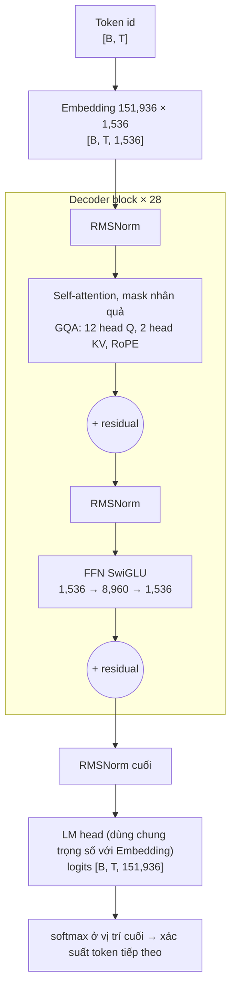

# Model card — Qwen2.5-1.5B-Instruct  (v2)
- Toàn (AI hỗ trợ), 2026-11-15 | Cập nhật: Toàn (AI hỗ trợ), 2026-11-16T01:40:17+07:00 | Ngày tra nguồn: 2026-11-14/15 | Trạng thái: **Duyệt: Toàn, 2026-11-16**
- Thay đổi so với v1: thêm sơ đồ kiến trúc mermaid theo `templates/MODEL_CARD_TEMPLATE_v2.md` (mẫu: `Lab-DL/labs/lab1/docs/models/mlp_baseline_v1.md`). Phần khác giữ nguyên. v1 giữ nguyên, không dùng.

## Purpose
Model chính của bài, dùng cho mọi mục có demo. So với bản base `Qwen2.5-1.5B` ở mục 5 để thấy tác dụng của post-training.

## Thông tin model
- **Nguồn:** https://huggingface.co/Qwen/Qwen2.5-1.5B-Instruct | **Giấy phép:** Apache-2.0 | **Cần token:** không (`gated: false`)
- **Kiến trúc:** Transformer decoder-only; RoPE, SwiGLU, RMSNorm, bias ở QKV, embedding vào/ra dùng chung (`tie_word_embeddings`)
- **Thông số** (model card + `config.json`):

| Thông số | Giá trị |
|---|---|
| Số tham số | 1.54 tỉ (1.31 tỉ không tính embedding) |
| Số decoder block | 28 |
| `hidden_size` | 1,536 |
| Head attention | 12 cho Q, 2 cho KV (GQA); mỗi head 128 chiều |
| `intermediate_size` (FFN) | 8,960 |
| `vocab_size` | 151,936 (tokenizer: byte-level BPE, 151,643 token thường + 22 token điều khiển) |
| Ngữ cảnh | 32,768 token; sinh tối đa 8,192 |
| `rope_theta` | 1,000,000 |
| Kiểu lưu trọng số | bfloat16 |
| Yêu cầu | `transformers` ≥ 4.37.0 (bản cũ báo `KeyError: 'qwen2'`) |

- **Giai đoạn huấn luyện:** pretraining (18 nghìn tỉ token) và post-training: SFT trên hơn 1 triệu mẫu, DPO khoảng 150 nghìn cặp, RL trực tuyến GRPO (Qwen2.5 Technical Report).
- **Kiểm lại số tham số** (tự tính từ `config.json`): 1,543,714,304, khớp model card. Chi tiết ở `docs/research/noi_dung_muc02_kien_truc_v1.md` §5.2.

## Sơ đồ kiến trúc
Thứ tự trong mỗi block (chuẩn hoá trước, rồi cộng residual) lấy từ mã `Qwen2DecoderLayer.forward` trong `transformers` (`models/qwen2/modeling_qwen2.py`, tra 2026-11-16) **[Bổ sung]**. Thông số lấy từ bảng trên.



- Residual cộng **đầu vào của khối con** (trước RMSNorm) với đầu ra của khối con đó.
- Model trả **logits**; softmax do code sinh văn bản (`generate()`) hoặc code của nhóm tự gọi, không nằm trong model.

| Thành phần | Cách tính | Số tham số |
|---|---|---:|
| Embedding (dùng chung với LM head) | 151,936 × 1,536 | 233,373,696 |
| Attention mỗi block | Q: 1,536×1,536 + 1,536 · K, V: 1,536×256 + 256 mỗi cái · O: 1,536×1,536 (không bias) | 5,507,072 |
| FFN mỗi block | 3 × 1,536 × 8,960 (gate, up, down) | 41,287,680 |
| RMSNorm mỗi block | 2 × 1,536 | 3,072 |
| Một block | | 46,797,824 |
| 28 block + RMSNorm cuối (1,536) | | 1,310,340,608 |
| **Tổng** | | **1,543,714,304** |

Số tự tính lại bằng Python ngày 2026-11-16; khớp model card (1.54 tỉ, 1.31 tỉ không tính embedding). Bias của Q, K, V và O không bias: theo `modeling_qwen2.py`.

## Cách lấy
```python
import torch
from transformers import AutoTokenizer, AutoModelForCausalLM
tok = AutoTokenizer.from_pretrained("Qwen/Qwen2.5-1.5B-Instruct")
model = AutoModelForCausalLM.from_pretrained(
    "Qwen/Qwen2.5-1.5B-Instruct", torch_dtype=torch.float16, device_map="auto")
model.eval()
```
- Dung lượng: khoảng 3.1 GB (1.54 tỉ × 2 byte, tự tính).
- Lưu ở bộ nhớ đệm Hugging Face; không commit.
- Kaggle phải bật **Internet**.
- **Chưa chạy thử**: kiểm ở smoke run Ngày 1.

## Cách dùng trong bài
- **Mục / phần notebook:** 0 (tải), 1, 2, 3, 4, 5, 6, 7, 8, 9, 10.
- **dtype:** `torch.float16`. T4 không hỗ trợ bf16 bằng phần cứng; nếu output fp16 lạ thì dùng `float32` (khoảng 6.2 GB).
- **Định dạng đầu vào:** `tok.apply_chat_template(messages, add_generation_prompt=True, ...)`.
- **Gotchas:**
  - `generation_config.json` mặc định `do_sample: true`, `temperature 0.7`, `top_p 0.8`, `top_k 20`, `repetition_penalty 1.1` → **luôn truyền tham số sinh tường minh**; greedy là `do_sample=False`.
  - Cần trọng số attention (phần 2) thì nạp với `attn_implementation="eager"`.
  - Dùng `apply_chat_template(..., tokenize=False)` rồi gọi `tok(text)` thì có thể thêm token đặc biệt hai lần → truyền `add_special_tokens=False`, hoặc dùng `tokenize=True, return_tensors="pt"`.

## Log ghi gì về model
- Tên model + revision (commit hash trên Hub), dtype, device_map, kiến trúc in từ `model.config` (số block, hidden, head Q/KV, FFN, vocab, context), số tham số đếm bằng code; theo `templates/RUN_LOG_TEMPLATE_v2.md` §2.1.
