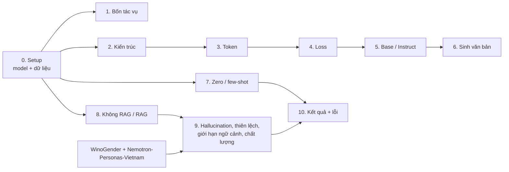

# Phần 0 — Yêu cầu của đề, kiến thức nền và Setup

- **Created**: 2026-11-28 (Toàn, AI hỗ trợ, Claude Code). Trạng thái **[đề xuất]**, chờ Toàn duyệt.
- **Nội dung:** yêu cầu của đề và bản đồ notebook, kiến thức toán tối thiểu, phần 0 Setup (cell 0.1–0.8).
- **Số liệu:** run chính thức `20261128_041850_normal` (Kaggle, GPU T4 x2, float16, seed 42, 22.0 phút, 188 cell; G-Eval chấm 20 lần lấy trung bình). Phần 1–9 và 10.1–10.3b trùng từng file kết quả với run `20261127_234527_normal`, `20261125_214650_normal`, `20261121_010447_normal` (chỉ khác cột thời gian, bộ nhớ); riêng 10.3c, 10.3d đổi theo giám khảo (xem mục 10). **VRAM 6.6, 9.5 lấy run `20261127_234527_normal`**: run chính thức đo lệch +2.97 GiB vì model của lần chạy dừng giữa chừng còn trên GPU. Bảng ở `outputs/results/`, hình ở `outputs/figures/`.
- **Ký hiệu nguồn:** **[Slide ChX]** slide môn học; **[Bổ sung]** nguồn có trong `docs/references.md`; **[Tự tính]** tính lại từ số trong notebook; **[Suy luận]** giải thích của nhóm, chưa đo.
- **Code** chép từ `notebook/llm_presentation.ipynb`; dòng ghi log, gọi `show_input()` và vài dòng in phụ được lược (`# ...`). Mở notebook, tìm số cell (ví dụ "# 4.2") để xem nguyên cell.

---

## Yêu cầu của đề và bản đồ notebook

**Topic:** Tìm hiểu mô hình ngôn ngữ lớn — Large Language Models (LLMs).
**Mục tiêu:** giải thích được cách LLM **học** và **sinh văn bản**, phân biệt **các giai đoạn huấn luyện**, nhận biết **khả năng** và **hạn chế**.

| # | Cô yêu cầu trình bày | Cô yêu cầu minh họa | Lý thuyết chính | Cell code | Output / hình |
|---|---|---|---|---|---|
| 1 | LLM là gì; LM vs LLM vs chatbot | Hỏi đáp, tóm tắt, dịch, sinh mã | LM, LLM, chatbot, chat template | 1.1–1.5 | `tasks_outputs.csv` |
| 2 | Transformer; decoder-only, causal attention | Sơ đồ token → xác suất token tiếp theo | Self-attention, causal mask, GQA, RoPE, softmax | 2.1–2.5 | `causal_mask.png`, `attention_qwen.png`, `top5_next_tokens.csv` |
| 3 | Token, token ID, embedding | Tokenize câu Việt và câu Anh | BPE, byte-level, UTF-8, embedding | 3.1–3.5 (+3.1b) | `token_counts.csv`, `embedding_qwen.png` |
| 4 | Next-token prediction, dữ liệu, cross-entropy | Cặp ngữ cảnh → token mục tiêu | Cross-entropy, dịch nhãn, perplexity | 4.1–4.5 | `per_token_loss.csv`, `loss_summary.csv`, `context_target_pairs.png`, `per_token_loss.png` |
| 5 | Pretraining, SFT, alignment; RLHF/DPO | Sơ đồ mục tiêu + dữ liệu từng giai đoạn | SFT loss, reward model, PPO + KL, DPO | 5.0–5.4 | `training_stages.png`, `base_vs_instruct.csv` |
| 6 | Autoregressive; greedy, temperature, top-p | Cùng prompt, nhiều cấu hình sinh | Vòng sinh, argmax, $p^{1/T}$, nucleus | 6.1–6.4 | `decoding_*.csv`, `temperature_top_p.csv` |
| 7 | In-context learning, làm theo chỉ dẫn | Zero-shot vs few-shot cùng tác vụ | ICL, thí nghiệm một biến, chống rò rỉ | 7.1–7.5 | `icl_zero_shot.csv`, `icl_few_shot.csv` |
| 8 | Prompting vs fine-tuning vs RAG | Bảng dữ liệu cần có, khi nào dùng | TF-IDF, cosine, recall@k, LoRA | 8.1–8.4 | `rag_results.csv` |
| 9 | Hallucination, thiên lệch, giới hạn ngữ cảnh; chất lượng phụ thuộc tác vụ, dữ liệu | 1 câu trả lời sai + cách kiểm chứng | Hallucination, SimpleQA; đo thiên lệch bằng xác suất câu, tương quan Pearson; cửa sổ ngữ cảnh, KV cache | 9.1–9.6 | `hallucination_*.csv`, `bias_*.csv`, `context_*.csv`, `quality_by_*.csv`, `bias_scatter.png`, `context_cost.png`, `quality_by_data.png` |
| 10 | Thử nghiệm có kiểm soát, tổng hợp | Bảng kết quả, ví dụ, phân tích lỗi | Accuracy, CI, confusion, McNemar | 10.1–10.4 | `icl_metrics.json`, `confusion_matrix_icl.png`, `summary_table.csv` |

**Sản phẩm nộp:** slide PDF/PPTX; notebook + hướng dẫn chạy; bộ câu thử nghiệm + kết quả + phân tích lỗi; tài liệu tham khảo.
**Góp ý 11/11:** không cần fine-tune; **mục nào cũng có demo trên model thật kèm phân tích output**, kể cả mục 5 và 8.
**Yêu cầu thêm:** slide ghi thư viện, môi trường; mỗi mục có demo; có thực nghiệm; **giải thích được từng dòng notebook**; phần slide không có code thì mở notebook.

**Hình 0 — Sơ đồ notebook:**



Ba nhóm: **Bên trong LLM** (2–6) đi theo đường dữ liệu trong model: kiến trúc → token → cách học → giai đoạn huấn luyện → cách sinh. **Dùng LLM** (1, 7, 8). **Đánh giá** (9, 10): phần 9 dùng lại câu hỏi phần 8, phần 10 dùng lại kết quả phần 7.

**Quy ước chung của mọi cell** (đọc một lần, áp dụng cả notebook):
- Trước mỗi cell code có markdown ghi **Mục đích / Đầu vào / Đầu ra**; sau output có cell **Phân tích**.
- `with torch.no_grad():` ở mọi chỗ chạy model: chỉ suy luận, không tính gradient, **không train**. `model.eval()` tắt dropout.
- Cuối cell gần như luôn có `assert` để tự kiểm: sai là notebook dừng, không lặng lẽ ra số sai.
- Gọi `generate()` luôn truyền tham số sinh tường minh (lý do: cell 0.4).

---

## Kiến thức toán tối thiểu

| Khái niệm | Công thức / ý | Dùng ở cell |
|---|---|---|
| Vector, ma trận | Embedding mỗi token = vector 1,536 số; bảng embedding = ma trận 151,936 × 1,536 | 3.4 |
| Tích vô hướng | $a \cdot b = \sum_i a_i b_i$; hai vector cùng hướng thì lớn | 2.3, 8.2 |
| Xác suất có điều kiện | $P(B \mid A)$: xác suất B khi đã biết A | 2.4, 4.2 |
| Quy tắc dây chuyền [Bổ sung: Jurafsky & Martin ch. 3] | $P(x_1, \dots, x_n) = \prod_{i} P(x_i \mid x_1, \dots, x_{i-1})$ | 4.1 |
| Softmax [Slide Ch2] | $\text{softmax}(z)_i = e^{z_i} / \sum_j e^{z_j}$: biến điểm (logits) thành xác suất dương, cộng bằng 1 | 2.3, 2.4, 6.1 |
| Logarit | $\ln 1 = 0$; $p \to 0$ thì $-\ln p \to \infty$; $\ln(ab) = \ln a + \ln b$ | 4.2 |
| Nhị thức | $X \sim \text{Bin}(n, 0.5)$: số lần ngửa khi tung $n$ đồng xu công bằng | 10.2 |

**Vì sao quy tắc dây chuyền quan trọng:** nó cho thấy chỉ cần học "đoán token tiếp theo" là đủ để gán xác suất cho cả văn bản. Đây là nền của toàn bộ mục 2, 4, 6.

---

## Phần 0 — Setup

Phần 0 không ứng với mục nào của đề, nhưng trả lời yêu cầu thêm 1, 2 của cô (thư viện, môi trường) và chứng minh model tải đúng.

## Cell 0.1 — Cấu hình chung

> **Ý tưởng:** mọi tham số đặt một chỗ; **seed** cố định để chạy lại ra đúng kết quả; **SMOKE** để chạy thử ít mẫu không đè kết quả thật.

```python
SMOKE: bool = False  # True: chạy thử vài mẫu; False: chạy chính thức (Save & Run All)
SEED: int = 42
MODEL_INSTRUCT = "Qwen/Qwen2.5-1.5B-Instruct"  # model chính
MODEL_BASE = "Qwen/Qwen2.5-1.5B"               # bản base, chỉ tải ở phần 5
TOKENIZER_GPT2 = "openai-community/gpt2"       # chỉ lấy tokenizer, dùng ở phần 3
DTYPE = torch.float16                          # T4 không hỗ trợ bf16 bằng phần cứng
N_TEST: int | None = 20 if SMOKE else None     # None = toàn bộ 2,999 câu test
# ...
OUT_DIR = ROOT / "outputs" / "_smoke" if SMOKE else ROOT / "outputs"
RUN_ID = RUN_START.strftime("%Y%m%d_%H%M%S") + ("_smoke" if SMOKE else "_normal")
random.seed(SEED); np.random.seed(SEED); torch.manual_seed(SEED)
```

**Giải thích:**
- `DTYPE = torch.float16`: mỗi tham số 2 byte thay vì 4 (float32) → model 1.54 tỉ tham số chiếm ≈ 3.1 GB. T4 không có phần cứng `bf16`, nên chọn fp16.
- `N_TEST = None` → phần 7 chạy toàn bộ 2,999 câu.
- `OUT_DIR`: smoke ghi vào `outputs/_smoke/`, normal ghi vào `outputs/` → chạy thử không đè kết quả thật.
- `RUN_ID`: ngày giờ Việt Nam + chế độ → tên thư mục log.
- Ba lệnh `seed`: cố định mọi bộ sinh số ngẫu nhiên (Python, NumPy, PyTorch cả CPU và GPU).

**Output:** `RUN_ID : 20261127_234527_normal`, `N_TEST : toàn bộ test 2 nhãn`, `DATA_DIR: Kaggle Dataset llms-dl-data`.

## Cell 0.2 — Hàm ghi log
`log(text, part=None, to_run=False)`: không có `part` → ghi `run.log`; có `part` → ghi `partNN_<tên>.log`; mở file chế độ `"a"` (ghi thêm, không đè). Mọi phần mở bằng `=== PART NN ... START ===`, đóng bằng `=== ... END ===`.

## Cell 0.3 — Môi trường

```python
assert torch.cuda.is_available(), "Chưa bật GPU: Settings → Accelerator → GPU T4"
ENV = {"python": platform.python_version(), "torch": torch.__version__, "cuda": torch.version.cuda,
       "gpu": torch.cuda.get_device_name(0), "gpu_count": torch.cuda.device_count(),
       "gpu_vram_gb": round(torch.cuda.get_device_properties(0).total_memory / 1024**3, 1), ...}
for lib in ["transformers", "accelerate", "pandas", "pyarrow", "scikit-learn", "statsmodels", "matplotlib"]:
    ENV[lib] = pkg_version(lib)          # importlib.metadata.version(): đọc phiên bản đã cài
```

**Output thật**:
```text
python: 3.13.16 | torch: 2.11.0+cu130 | cuda: 13.0 | gpu: Tesla T4 | gpu_count: 2 | gpu_vram_gb: 14.6
transformers: 5.20.2 | accelerate: 1.15.0 | pandas: 2.3.3 | pyarrow: 23.0.1
scikit-learn: 1.6.1 | statsmodels: 0.15.0 | matplotlib: 3.10.0
```
**Giải thích:** phiên bản đọc bằng code, không gõ theo trí nhớ. `gpu_count: 2` vì Kaggle cấp T4 ×2; model chỉ dùng GPU 0 (cell 0.4).

| Thư viện | Dùng ở | Làm gì |
|---|---|---|
| `torch` | mọi phần | tensor, chạy model trên GPU, softmax |
| `transformers` | mọi phần | tải model, tokenizer, `generate()`, chat template |
| `accelerate` | 0.4 | hỗ trợ `device_map` |
| `pandas`, `pyarrow` | 0.7, 8.1 | đọc Parquet, làm bảng, ghi CSV |
| `scikit-learn` | 8.2 | TF-IDF |
| `statsmodels` | 10.2 | McNemar |
| `matplotlib` | 2.2, 2.3, 10.1 | vẽ hình |

## Cell 0.4 — Tải tokenizer và model chính

> **Lý thuyết:** `from_pretrained(tên)` tải file cấu hình + trọng số từ `huggingface.co/<tên>` về bộ nhớ đệm. **`generation_config`** là cấu hình sinh mặc định nhà phát triển đóng gói kèm model.

```python
tok = AutoTokenizer.from_pretrained(MODEL_INSTRUCT)
model = AutoModelForCausalLM.from_pretrained(
    MODEL_INSTRUCT,
    torch_dtype=DTYPE,   # float16
    device_map={"": 0},  # cả model lên GPU 0; "auto" có thể chia sang GPU 1 của T4 x2
)
model.eval()  # chỉ suy luận, không train (tắt dropout)
print(model.generation_config)
MODEL_REVISION = getattr(model.config, "_commit_hash", None) or model_info(MODEL_INSTRUCT).sha
```

**Output thật:**
```text
GenerationConfig { "bos_token_id": 151643, "do_sample": true, "eos_token_id": [151645, 151643],
  "pad_token_id": 151643, "repetition_penalty": 1.1, "temperature": 0.7, "top_k": 20, "top_p": 0.8 }
model chính: Qwen/Qwen2.5-1.5B-Instruct (revision 989aa7980e4cf806f80c7fef2b1adb7bc71aa306) | device: cuda:0
```

**Giải thích ngay tại output:**
- `"do_sample": true, temperature 0.7, top_p 0.8, top_k 20` → **mặc định bản Instruct lấy mẫu ngẫu nhiên**. Gọi `generate()` mà không truyền gì thì mỗi lần chạy ra một câu khác → không so sánh được. Vì vậy mọi phần sau truyền `do_sample=False, temperature=None, top_p=None, top_k=None` (greedy thuần). Lý thuyết lấy mẫu: phần 6.
- `"repetition_penalty": 1.1`: phạt token đã xuất hiện để giảm lặp (tài liệu `GenerationConfig` của Hugging Face: "1.0 means no penalty"; cơ chế gốc từ CTRL, Keskar et al. 2019 [Bổ sung\*]). Phần 5–9 đặt rõ 1.0 (không phạt); phần 1 không đặt nên dùng 1.1 (§13).
- `eos_token_id` có 2 giá trị: 151645 = `<|im_end|>` (hết lượt chat), 151643 = `<|endoftext|>` (hết văn bản). Gặp một trong hai thì dừng sinh (dùng ở phần 5).
- `revision`: mã commit trên Hub → người khác tải đúng bản trọng số này.

## Cell 0.5 — Kiến trúc và số tham số

> **Lý thuyết:** số tham số = tổng số phần tử của mọi ma trận trọng số. Đếm bằng code rồi đối chiếu model card để chắc chắn tải đúng model.

```python
cfg = model.config
ARCH = {"num_hidden_layers": cfg.num_hidden_layers, "hidden_size": cfg.hidden_size,
        "num_attention_heads": cfg.num_attention_heads, "num_key_value_heads": cfg.num_key_value_heads,
        "intermediate_size": cfg.intermediate_size, "vocab_size": cfg.vocab_size,
        "max_position_embeddings": cfg.max_position_embeddings, "tie_word_embeddings": cfg.tie_word_embeddings}
ARCH["n_params"] = sum(p.numel() for p in model.parameters())   # mỗi tensor đếm 1 lần
assert ARCH["n_params"] == 1_543_714_304, ARCH["n_params"]
```

**Output thật:**
```text
num_hidden_layers: 28 | hidden_size: 1,536 | num_attention_heads: 12 | num_key_value_heads: 2
intermediate_size: 8,960 | vocab_size: 151,936 | max_position_embeddings: 32,768
tie_word_embeddings: True | n_params: 1,543,714,304
```

**Giải thích:**
- `p.numel()` = số phần tử của tensor `p`; cộng hết = số tham số. `parameters()` trả mỗi tensor **một lần**, nên ma trận embedding dùng chung với LM head (`tie_word_embeddings: True`) chỉ đếm một lần.
- `max_position_embeddings: 32,768` = số vị trí tối đa model được cấu hình; khớp ngữ cảnh 32K trong Qwen2.5 report Bảng 1 → dùng làm **giới hạn ngữ cảnh** (mục 9).
- Phân rã chi tiết con số 1,543,714,304: cell 2.1.

## Cell 0.6 — Tokenizer GPT-2
Chỉ tải tokenizer (vài MB), không tải model. `assert gpt2_tok.vocab_size == 50_257`. Dùng ở phần 3 để so số token.

## Cell 0.7 — UIT-VSFC

```python
EXPECTED_ROWS = {"train": 11_426, "validation": 1_583, "test": 3_166}
LABEL_NAMES = {0: "negative", 2: "positive"}  # bỏ 1 = neutral
for split, n_expected in EXPECTED_ROWS.items():
    df = pd.read_parquet(f"{UIT_VSFC_BASE}/{split}/0000.parquet")
    assert len(df) == n_expected, (split, len(df))
    df = df[df["sentiment"].isin(LABEL_NAMES)].reset_index(drop=True)  # bỏ neutral
    vsfc[split] = df
```

**Output thật:**
```text
UIT-VSFC train: 11,426 dòng gốc → 10,968 dòng sau khi bỏ neutral {'positive': 5643, 'negative': 5325}
UIT-VSFC validation: 1,583 dòng gốc → 1,510 dòng sau khi bỏ neutral {'positive': 805, 'negative': 705}
UIT-VSFC test: 3,166 dòng gốc → 2,999 dòng sau khi bỏ neutral {'positive': 1590, 'negative': 1409}
```

**Giải thích:**
- Đọc Parquet thẳng từ nhánh chuyển đổi của Hugging Face vì script tải cũ của bộ này không chạy với `datasets` ≥ 4.0.
- `isin(LABEL_NAMES)` giữ nhãn 0 và 2 → bài toán **2 nhãn** (neutral ít và mơ hồ).
- Test 1,590 / 1,409 = 53% / 47%: gần cân bằng. Mốc "luôn đoán positive" chỉ được 53% → accuracy 89–92% ở phần 7 là xa mốc này.

## Cell 0.8 — Lưu `env.json`, `config.json`
`save_json()` ghi UTF-8, `ensure_ascii=False` (giữ chữ Việt), rồi đọc lại và `assert`.

## Câu hỏi tự kiểm

| Câu hỏi | Ý trả lời |
|---|---|
| Sao chọn Qwen2.5-1.5B? | Đủ nhỏ để chạy trên T4 miễn phí, hỗ trợ tiếng Việt, có bản base cùng kiến trúc để so ở mục 5 |
| Sao float16 mà không bf16? | T4 không hỗ trợ bf16 bằng phần cứng; float16 2 byte/tham số → khoảng 3.1 GB |
| Sao phải truyền tham số sinh tường minh? | Bản Instruct mặc định lấy mẫu ngẫu nhiên; không truyền thì mỗi lần chạy một khác, không so sánh được |

---
