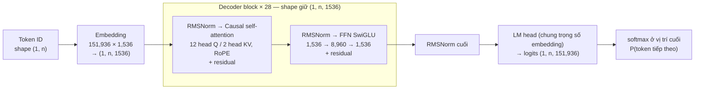

# Mục 2 — Nền tảng kiến trúc: Transformer decoder-only, causal attention

- **Created**: 2026-11-28 (Toàn, AI hỗ trợ, Claude Code). Trạng thái **[đề xuất]**, chờ Toàn duyệt.
- **Nội dung:** kiến trúc Qwen2.5-1.5B, causal mask, trọng số attention thật, top-5 token tiếp theo (cell 2.1–2.5).
- **Số liệu:** run chính thức `20261128_041850_normal` (Kaggle, GPU T4 x2, float16, seed 42, 22.0 phút, 188 cell; G-Eval chấm 20 lần lấy trung bình). Phần 1–9 và 10.1–10.3b trùng từng file kết quả với run `20261127_234527_normal`, `20261125_214650_normal`, `20261121_010447_normal` (chỉ khác cột thời gian, bộ nhớ); riêng 10.3c, 10.3d đổi theo giám khảo (xem mục 10). **VRAM 6.6, 9.5 lấy run `20261127_234527_normal`**: run chính thức đo lệch +2.97 GiB vì model của lần chạy dừng giữa chừng còn trên GPU. Bảng ở `outputs/results/`, hình ở `outputs/figures/`.
- **Ký hiệu nguồn:** **[Slide ChX]** slide môn học; **[Bổ sung]** nguồn có trong `docs/references.md`; **[Tự tính]** tính lại từ số trong notebook; **[Suy luận]** giải thích của nhóm, chưa đo.
- **Code** chép từ `notebook/llm_presentation.ipynb`; dòng ghi log, gọi `show_input()` và vài dòng in phụ được lược (`# ...`). Mở notebook, tìm số cell (ví dụ "# 4.2") để xem nguyên cell.

---

> **Cô yêu cầu → notebook đáp ứng**
> - Nội dung cần trình bày: *Vai trò của Transformer; tập trung vào Decoder-only và causal attention*.
> - Yêu cầu minh họa: *Sơ đồ từ token đầu vào đến xác suất token tiếp theo*.
> - Đáp ứng: Sơ đồ token → xác suất (markdown đầu phần 2 + khối Note); cell 2.2 ma trận causal mask; 2.3 attention thật (phía trên đường chéo = 0); 2.4 phân phối token tiếp theo.
> - Góp ý 11/11 và yêu cầu thêm 3: demo trên model thật, output thật, có phân tích.

## Note lý thuyết để hiểu (dùng cho cả phần 2)

**Vì sao Transformer thay RNN** [Slide Ch6 + Bổ sung: Vaswani et al. 2017]: RNN/LSTM đọc tuần tự, token 100 chờ 99 bước, khó song song, thông tin xa phai dần. Transformer dùng **self-attention**: mỗi token nhìn trực tiếp mọi token được phép trong một bước, tính song song trên GPU.

**Ba họ Transformer** [Bổ sung: HF LLM Course]:
| Họ | Ví dụ | Attention | Huấn luyện | Dùng cho |
|---|---|---|---|---|
| Encoder-only | BERT | Hai chiều | Che từ rồi đoán lại | Phân loại, trích xuất |
| **Decoder-only** | GPT, Llama, **Qwen** | **Một chiều (causal)** | **Đoán token tiếp theo** | Sinh văn bản, chat |
| Encoder-decoder | T5, BART | Encoder 2 chiều + decoder causal | Khôi phục đoạn bị che | Dịch, tóm tắt |

Hầu hết LLM là decoder-only vì bài toán huấn luyện (đoán token tiếp) **trùng** cách dùng (sinh từng token).

**Hình 1 — Sơ đồ token → xác suất token tiếp theo** (minh họa của đề; ảnh đính kèm đầu phần 2, số lấy từ `model.config`):



**Đọc hình theo shape:** "Hôm nay trời rất" → 6 token ID `(1, 6)` → embedding `(1, 6, 1536)` → 28 block giữ nguyên shape (attention trộn thông tin **giữa** các token; FFN biến đổi **từng** token) → LM head `(1, 6, 151936)` → lấy vị trí cuối, softmax → 151,936 xác suất cộng bằng 1. Kết quả thật của đường đi này: cell 2.4.

**Các khối trong sơ đồ** [Bổ sung: Vaswani 2017; model card Qwen2.5; Bổ sung: bài gốc từng kỹ thuật, `docs/references.md`]:

| Khối | Công thức | Vì sao dùng |
|---|---|---|
| Self-attention | $\text{Attention}(Q,K,V) = \text{softmax}\!\left(\dfrac{QK^\top}{\sqrt{d_k}} + M\right)V$, với $Q = XW_Q$, $K = XW_K$, $V = XW_V$ | Mỗi token lấy thông tin từ token khác theo mức liên quan |
| Causal mask | $M_{ij} = 0$ nếu $j \le i$; $-\infty$ nếu $j > i$ | Không nhìn tương lai (chi tiết cell 2.2) |
| Multi-head | 12 head chạy song song, nối lại rồi nhân $W_O$ | Mỗi head học một kiểu quan hệ |
| GQA | 12 head Q, 2 head K/V → 6 head Q dùng chung 1 cặp K, V | Giảm KV cache khi sinh, ít tham số |
| RoPE | Xoay từng cặp chiều của $q, k$ góc $m\theta_i$, $\theta_i = \text{base}^{-2(i-1)/d}$. Bài gốc dùng base = 10,000 [Bổ sung\*: Su et al. 2021 §3.2.2]; Qwen2.5 tăng lên 1,000,000 (kỹ thuật ABF) để kéo dài ngữ cảnh [Bổ sung: Qwen2.5 report §3.3] | Tích $q_m \cdot k_n$ chỉ phụ thuộc khoảng cách tương đối giữa hai vị trí → model biết thứ tự |
| RMSNorm | $\dfrac{x}{\sqrt{\frac1d\sum_i x_i^2 + \epsilon}} \odot g$ | Như LayerNorm, không trừ trung bình, rẻ hơn |
| Pre-norm + residual (Qwen2.5 report §2: "RMSNorm… with pre-normalization") | $h = x + \text{Attn}(\text{RMSNorm}(x))$; $y = h + \text{FFN}(\text{RMSNorm}(h))$ | Residual như ResNet [Slide Ch5]: gradient đi thẳng qua 28 block |
| SwiGLU FFN | $W_{\text{down}}\big(\text{SiLU}(W_{\text{gate}}x) \odot W_{\text{up}}x\big)$, $\text{SiLU}(x) = x\,\sigma(x)$ | Cổng nhân giúp biểu diễn tốt hơn; vì vậy FFN có **3** ma trận |
| LM head | logits $= h\,E^\top$ | Dùng chung $E$ với embedding → bớt 233 triệu tham số |

**Vì sao chia $\sqrt{d_k}$** ($d_k = 128$): nếu các thành phần của $q, k$ có trung bình 0, phương sai 1 thì $q \cdot k$ có phương sai $d_k$. Không chia thì điểm rất lớn, softmax "bão hoà" (một ô ≈ 1, còn lại ≈ 0), gradient gần 0.

## Cell 2.1 — Thông số và 1.5 tỉ tham số nằm ở đâu

```python
PARAM_GROUPS = {"embedding": 0, "attention": 0, "ffn": 0, "norm": 0, "khác": 0}
for name, p in model.named_parameters():
    key = ("embedding" if "embed_tokens" in name else "attention" if "self_attn" in name
           else "ffn" if "mlp" in name else "norm" if "norm" in name else "khác")
    PARAM_GROUPS[key] += p.numel()
MODEL_CONFIG = {..., "head_dim": ARCH["hidden_size"] // ARCH["num_attention_heads"],          # 1536 / 12
                "q_heads_per_kv_head": ARCH["num_attention_heads"] // ARCH["num_key_value_heads"],  # GQA
                "rope_theta": rope_theta, "n_params_by_group": PARAM_GROUPS, ...}
assert sum(PARAM_GROUPS.values()) == ARCH["n_params"]
assert PARAM_GROUPS["embedding"] == ARCH["vocab_size"] * ARCH["hidden_size"]
assert PARAM_GROUPS["khác"] == 0
```

**Giải thích code:** tên tham số trong Qwen có dạng `model.layers.5.self_attn.q_proj.weight`, `model.layers.5.mlp.gate_proj.weight`… nên gom theo chuỗi con của tên. `assert` nhóm "khác" = 0 bảo đảm không bỏ sót tham số nào.

**Output thật:**
```text
embedding      233,373,696
attention      154,198,016
ffn          1,156,055,040
norm                87,552
khác                     0
Không tính embedding: 1,310,340,608 | head_dim 128 | 6 head Q / 1 head KV | rope_theta 1,000,000
```

**Giải thích output bằng công thức** [Tự tính, khớp từng chữ số]:
| Nhóm | Công thức | Kết quả |
|---|---|---|
| Embedding | $151{,}936 \times 1{,}536$ | 233,373,696 ✓ |
| Attention / block | $W_Q$: $1536 \times 1536 + 1536$ (bias) ; $W_K$, $W_V$: mỗi cái $1536 \times 256 + 256$ ($256 = 2 \text{ head KV} \times 128$) ; $W_O$: $1536 \times 1536$ | 5,507,072 |
| Attention × 28 | $5{,}507{,}072 \times 28$ | 154,198,016 ✓ |
| FFN × 28 | $3 \times 1536 \times 8960 \times 28$ (gate, up, down) | 1,156,055,040 ✓ |
| Norm | $2 \times 1536 \times 28 + 1536$ (2 RMSNorm/block + norm cuối) | 87,552 ✓ |
| **Tổng** | | **1,543,714,304** ✓ |

- **FFN ≈ 75%** tham số; attention chỉ ≈ 10% vì GQA làm $W_K$, $W_V$ nhỏ hơn $W_Q$ 6 lần.
- `head_dim 128` = 1536 / 12; `6 head Q / 1 head KV` = 12 / 2.
- Bộ nhớ: 1,543,714,304 × 2 byte = 3.09 × 10⁹ byte ≈ **2.88 GiB**, đúng con số VRAM in ở cell 2.3.

## Cell 2.2 — Causal mask → Hình 2

> **Lý thuyết ở cell này** [Bổ sung: Vaswani §3.2.3]: trong decoder, vị trí $i$ chỉ được chú ý tới vị trí $\le i$. Cách làm: cộng $M_{ij} = -\infty$ vào điểm trước softmax; vì $e^{-\infty} = 0$, trọng số tương lai **đúng bằng 0**.
> - **Vì sao −∞ chứ không đặt điểm = 0:** điểm 0 cho $e^0 = 1$, vẫn nhận trọng số dương, tức vẫn nhìn trộm tương lai.
> - **Vì sao cần:** (1) khi huấn luyện, cả câu đưa vào một lần; không mask thì vị trí "trời" thấy luôn "rất" → chép đáp án, không học được; (2) khi sinh, token tương lai chưa tồn tại → mask làm lúc train giống lúc dùng; (3) token cũ không phụ thuộc token mới → lưu lại K, V cũ (**KV cache**).

```python
def causal_mask(n: int) -> torch.Tensor:
    return torch.tril(torch.ones(n, n, dtype=torch.bool))  # tril = giữ tam giác dưới (gồm đường chéo)

def token_labels(tok, ids: list[int]) -> list[str]:
    return [tok.decode([i]) for i in ids]     # decode riêng từng ID cho dễ đọc

MASK_TEXT = "Hôm nay trời rất đẹp."
mask_ids = tok(MASK_TEXT, add_special_tokens=False)["input_ids"]
M = causal_mask(len(mask_ids))
ax.imshow(M.int(), cmap="Blues", vmin=0, vmax=1.4)          # vẽ ma trận, mỗi ô ghi 0/1
# ...
assert torch.equal(M, M.tril()); assert M.diagonal().all(); assert not M.triu(diagonal=1).any()
```

**Giải thích code:** `torch.ones(n, n)` toàn 1 → `tril` đặt 0 cho phần trên đường chéo. `add_special_tokens=False`: không thêm token đặc biệt, chỉ token của câu. `triu(diagonal=1)` = phần **trên** đường chéo; `assert` nó toàn 0.

**Output:** `causal mask: 'Hôm nay trời rất đẹp.' → 8 token ['H', 'ôm', ' n', 'ay', ' trời', ' rất', ' đẹp', '.']` và hình:


**Đọc hình 2:**
- Trục dọc (**query**) = token đang được tính; trục ngang (**key**) = token nó được nhìn.
- Ô **1 (xanh)** = được nhìn; ô **0 (trắng)** = bị chặn.
- Hàng `'H'`: 1 ô (chính nó). Hàng `'.'`: 8 ô (cả câu).
- Số ô 1 = $1 + 2 + \dots + 8 = n(n+1)/2 = 36$; ô 0 = 28.
- Đây là **quy tắc** do code vẽ, chưa phải số của model. Số thật: cell 2.3.
- Câu 5 từ thành **8 token** vì "Hôm" = "H" + "ôm", "nay" = " n" + "ay" (giải thích ở cell 3.1).

## Cell 2.3 — Trọng số attention thật → Hình 3

> **Lý thuyết ở cell này:** trọng số attention = ma trận $\text{softmax}(QK^\top/\sqrt{d_k} + M)$ (chưa nhân $V$). Mỗi hàng là một phân phối xác suất: cộng bằng 1, phần tương lai bằng 0.

```python
model_eager = AutoModelForCausalLM.from_pretrained(
    MODEL_INSTRUCT, revision=MODEL_REVISION, torch_dtype=DTYPE, device_map={"": 0},
    attn_implementation="eager",   # tính attention bằng phép nhân ma trận thường → trả được trọng số
)
model_eager.eval()
print(f"VRAM sau khi nạp bản eager: {vram_used_gb()} GB")
ATTN_LAYER, ATTN_HEAD = 0, 0
with torch.no_grad():
    out_eager = model_eager(torch.tensor([mask_ids], device=model_eager.device), output_attentions=True)
# out_eager.attentions: tuple 28 phần tử (mỗi layer một), mỗi phần tử shape (batch, số head Q, n, n)
attn = out_eager.attentions[ATTN_LAYER][0, ATTN_HEAD].float().cpu()
# ... vẽ imshow viridis, ghi số 2 chữ số thập phân vào từng ô
assert len(out_eager.attentions) == ARCH["num_hidden_layers"]
assert torch.all(attn.triu(diagonal=1) == 0)                                  # tương lai = 0
assert torch.allclose(attn.sum(-1), torch.ones(n_mask), atol=1e-2)            # mỗi hàng = 1
del model_eager, out_eager
print(f"VRAM sau khi xoá bản eager: {free_vram()} GB")
```

**Giải thích code:**
- **Vì sao nạp lại model bản `eager`:** cách tính mặc định **SDPA** là một hàm gộp tối ưu, tính thẳng ra output, không giữ ma trận trọng số. Bản `eager` tính đúng từng bước của công thức nên trả được `attentions`.
- `output_attentions=True`: yêu cầu model trả trọng số.
- `[ATTN_LAYER][0, ATTN_HEAD]`: layer 0 → batch 0 → head 0 → ma trận `(8, 8)`.
- `atol=1e-2`: cho phép sai số 0.01 vì fp16 làm tròn.
- `del` + `free_vram()` (`gc.collect()` + `torch.cuda.empty_cache()`): trả bộ nhớ GPU.

**Output thật:**
```text
VRAM sau khi nạp bản eager: 5.76 GB
attention layer 0 head 0: tổng phần trên đường chéo = 0.000000 | tổng mỗi hàng = [1.0, 1.0, 1.0, 1.0, 1.0, 1.0, 1.0, 1.0]
VRAM sau khi xoá bản eager: 2.88 GB
```


**Số trong hình 3** (hàng = query, cột = key):
| Query \ Key | H | ôm | n | ay | trời | rất | đẹp | . |
|---|---|---|---|---|---|---|---|---|
| H | **1.00** | | | | | | | |
| ôm | 0.35 | **0.65** | | | | | | |
| n | 0.03 | **0.90** | 0.07 | | | | | |
| ay | 0.18 | 0.37 | 0.08 | **0.37** | | | | |
| trời | 0.11 | 0.30 | 0.11 | 0.11 | **0.38** | | | |
| rất | 0.04 | 0.34 | 0.03 | 0.10 | 0.07 | **0.43** | | |
| đẹp | 0.02 | 0.04 | 0.02 | 0.03 | 0.04 | 0.23 | **0.62** | |
| . | 0.03 | 0.03 | 0.05 | 0.03 | 0.01 | 0.08 | 0.02 | **0.76** |

**Giải thích output và hình 3:**
1. **VRAM 2.88 → 5.76 → 2.88 GB:** thêm một bản model fp16 ≈ 2.88 GiB (khớp tính ở cell 2.1), xoá xong trở về.
2. **Tam giác trên toàn 0.00:** đúng mask của hình 2. Đây là **bằng chứng causal attention có tác dụng trong model thật**, không chỉ trên lý thuyết.
3. **Mỗi hàng cộng = 1.0:** vì softmax theo hàng. Ví dụ hàng "ay": 0.18 + 0.37 + 0.08 + 0.37 = 1.00.
4. **Hàng "H" = 1.00 là bắt buộc:** chỉ một ô được phép; softmax của một phần tử luôn bằng 1. Không có nghĩa model "chú ý mạnh".
5. **Đường chéo tăng dần từ "trời" về cuối câu** (0.38 → 0.43 → 0.62 → 0.76; không đều ở đầu câu: " n" chỉ 0.07): ở nửa sau câu, head này dồn nhiều trọng số vào chính token đang xét.
6. **Cột "ôm" nhận trọng số lớn từ nhiều hàng** (0.90, 0.37, 0.30, 0.34): head dồn chú ý vào một token đầu câu. [Bổ sung\*, Suy luận] Hiện tượng nhiều head dồn trọng số vào vài token đầu đã được ghi nhận ở LLM ("attention sink", Xiao et al. 2023); với 1 câu, 1 head thì chưa kết luận được nguyên nhân.
7. **"đẹp" nhìn "rất" 0.23:** token liền trước. [Suy luận] Head ở layer thấp thường nhìn token lân cận; ở đây chỉ thấy trên 1 head, chưa đủ để khái quát.
8. **Đừng diễn giải quá:** đây là 1 trong **28 × 12 = 336 head**, ở layer gần embedding nhất. Muốn xem head khác: sửa `ATTN_LAYER`, `ATTN_HEAD`.

## Cell 2.4 — Top-5 token tiếp theo

> **Lý thuyết ở cell này:** đúng đường đi của hình 1. Logits ở **vị trí cuối** là điểm cho token tiếp theo; softmax biến thành phân phối trên 151,936 token. Đầu ra của LLM **không phải một từ** mà là **cả phân phối**.

```python
def top_k_next_tokens(model, tok, text: str, k: int = 5):
    ids = tok(text, return_tensors="pt", add_special_tokens=False)["input_ids"].to(model.device)
    with torch.no_grad():
        logits = model(ids).logits[0, -1].float()  # chỉ lấy vị trí cuối: mỗi token trong từ điển một điểm
    probs = torch.softmax(logits, dim=-1)          # điểm → xác suất, cộng lại = 1
    top = torch.topk(probs, k)
    # ... bảng rank, token_id, token, prob
TOPK_TEXT = "Hôm nay trời rất"
```

**Giải thích code:** `model(ids).logits` shape `(1, 6, 151936)`; `[0, -1]` lấy batch 0, vị trí cuối → vector 151,936 số. `.float()` đổi fp16 → fp32 cho softmax chính xác. Văn bản thô, **không** chat template (đang xem model như một LM viết tiếp).

**Output thật:**
```text
INPUT: 'Hôm nay trời rất' (6 token)
 rank  token_id token     prob
    1    128501   đẹp 0.787874
    2    136583  nắng 0.063174
    3    130823  lạnh 0.045503
    4    131484  nóng 0.028923
    5       220       0.007144
Tổng xác suất top-5: 0.9326 (phần còn lại chia cho 151,931 token khác)
```

**Giải thích:**
- " đẹp" 0.788: [Suy luận] "trời rất đẹp" là cụm rất phổ biến trong văn bản tiếng Việt (không kiểm được vì dữ liệu huấn luyện không công bố).
- Bốn ứng viên đầu đều là **tính từ** hợp với "trời" ("đẹp", "nắng", "lạnh", "nóng"): phân phối dồn vào các token vừa đúng ngữ pháp (sau "rất" là tính từ) vừa hợp nghĩa (chủ đề "trời").
- Hạng 5 là token 220 = **một dấu cách** riêng lẻ. [Suy luận] Văn bản web có chỗ gõ thừa dấu cách, hoặc từ tiếp theo bị tokenizer tách thành " " + từ không có dấu cách.
- Top-5 cộng 0.933 < 1; 0.067 còn lại trải trên 151,931 token khác.

**Biểu đồ mới ở cell 2.4** (`figures/top5_next_tokens.png`): cột ngang cho 5 xác suất trên. Hình cho thấy ngay " đẹp" áp đảo, 4 token còn lại cộng chưa tới 0.15.

## Cell 2.5 — Tổng kết phần 2
`assert` đủ 2 file kết quả + 2 hình, ghi log. Output: `tổng kết: top-1 sau 'Hôm nay trời rất' = ' đẹp' (0.788) | causal mask 8×8 | attention phần trên đường chéo = 0`.

## Câu hỏi tự kiểm

| Câu hỏi | Ý trả lời |
|---|---|
| Decoder-only khác BERT ở đâu? | BERT nhìn hai chiều, hợp để hiểu; decoder-only chỉ nhìn quá khứ, hợp để sinh |
| Không có causal mask thì sao? | Khi train model nhìn thấy token cần đoán, học "chép" chứ không học dự đoán |
| GQA là gì? | Nhiều head Q dùng chung một cặp K, V; ít bộ nhớ hơn khi sinh |
| Vì sao chia $\sqrt{d}$? | Tích vô hướng lớn dần theo số chiều; chia để softmax không quá nhọn |
| LM head là gì? | Lớp tuyến tính 1,536 → 151,936; ở Qwen dùng chung trọng số với bảng embedding |

---
