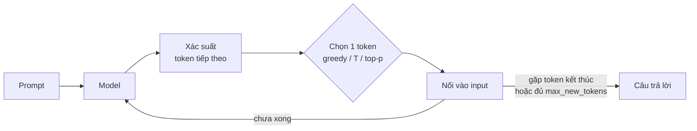

# Mục 6 — Quá trình sinh văn bản: greedy, temperature, top-p

- **Created**: 2026-11-28 (Toàn, AI hỗ trợ, Claude Code). Trạng thái **[đề xuất]**, chờ Toàn duyệt.
- **Nội dung:** sinh từng bước, temperature và top-p, 5 cấu hình × 3 lần, độ đa dạng, hiệu quả thực thi (cell 6.1–6.6).
- **Số liệu:** run chính thức `20261128_041850_normal` (Kaggle, GPU T4 x2, float16, seed 42, 22.0 phút, 188 cell; G-Eval chấm 20 lần lấy trung bình). Phần 1–9 và 10.1–10.3b trùng từng file kết quả với run `20261127_234527_normal`, `20261125_214650_normal`, `20261121_010447_normal` (chỉ khác cột thời gian, bộ nhớ); riêng 10.3c, 10.3d đổi theo giám khảo (xem mục 10). **VRAM 6.6, 9.5 lấy run `20261127_234527_normal`**: run chính thức đo lệch +2.97 GiB vì model của lần chạy dừng giữa chừng còn trên GPU. Bảng ở `outputs/results/`, hình ở `outputs/figures/`.
- **Ký hiệu nguồn:** **[Slide ChX]** slide môn học; **[Bổ sung]** nguồn có trong `docs/references.md`; **[Tự tính]** tính lại từ số trong notebook; **[Suy luận]** giải thích của nhóm, chưa đo.
- **Code** chép từ `notebook/llm_presentation.ipynb`; dòng ghi log, gọi `show_input()` và vài dòng in phụ được lược (`# ...`). Mở notebook, tìm số cell (ví dụ "# 4.2") để xem nguyên cell.
- **Bộ đánh giá** (thẻ ở notebook cell 10.5, `figures/suite_*.png`): E4, E5.

---

> **Cô yêu cầu → notebook đáp ứng**
> - Nội dung cần trình bày: *Autoregressive generation; greedy decoding, temperature và top-p sampling*.
> - Yêu cầu minh họa: *Cùng một prompt với các cấu hình sinh khác nhau*.
> - Đáp ứng: Cell 6.1 vòng lặp sinh từng bước = `generate()`; 6.2 temperature, top-p trên phân phối thật + biểu đồ; 6.3 cùng prompt × 5 cấu hình × 3 lần.
> - Góp ý 11/11 và yêu cầu thêm 3: demo trên model thật, output thật, có phân tích.

## Note lý thuyết để hiểu (dùng cho cả phần 6)

**Autoregressive** [Slide Ch6 + Bổ sung]: sinh từng token, token vừa sinh **nối vào input** để sinh token kế:

$$y_t \sim P_\theta(\cdot \mid x, y_1, \dots, y_{t-1}), \quad t = 1, 2, \dots$$

Dừng khi gặp token kết thúc hoặc đủ `max_new_tokens`.

**Hình 4 — Vòng sinh từng token** (ảnh đính kèm đầu phần 6):



Đọc hình: câu trả lời dài 60 token thì model chạy 60 lần. **Khối hình thoi** là chỗ duy nhất khác nhau giữa các cách giải mã: model và phân phối giống hệt.

| Cách chọn | Công thức | Tính chất |
|---|---|---|
| Greedy | $y_t = \arg\max_i p_i$ | Tất định, lặp lại được; dễ lặp, nhạt |
| Temperature $T$ | $p_i^{(T)} = \dfrac{e^{z_i/T}}{\sum_j e^{z_j/T}}$ | $T<1$ nhọn hơn; $T>1$ phẳng hơn; $T \to 0$ ≈ greedy |
| Top-p (nucleus) [Holtzman 2020] | Giữ tập nhỏ nhất $V_p$ có $\sum_{i \in V_p} p_i \ge p$, chia lại xác suất, lấy mẫu | Cắt đuôi; số ứng viên tự co giãn |
| Top-k | Giữ $k$ token cao nhất | Số ứng viên cố định (notebook tắt bằng `top_k=0`) |

**Hệ quả của temperature** [Tự tính từ công thức]: $e^{z_i/T} = (e^{z_i})^{1/T}$ nên

$$p_i^{(T)} \propto p_i^{1/T} \quad\Rightarrow\quad \frac{p_a^{(T)}}{p_b^{(T)}} = \left(\frac{p_a}{p_b}\right)^{1/T}$$

Tỉ lệ giữa hai token bị lũy thừa $1/T$. Kiểm bằng số thật ở cell 6.2.

## Cell 6.1 — Sinh từng bước bằng vòng lặp tự viết

```python
GEN_PROMPT = "Viết một câu giới thiệu ngắn về thành phố Hà Nội."
gen_enc = tok.apply_chat_template([{"role": "user", "content": GEN_PROMPT}], add_generation_prompt=True,
                                  return_tensors="pt", return_dict=True).to(model.device)
N_STEPS = 8
ids = gen_enc["input_ids"]
with torch.no_grad():
    for step in range(1, N_STEPS + 1):
        logits = model(ids).logits[0, -1].float()        # điểm cho token tiếp theo (chỉ vị trí cuối)
        probs = torch.softmax(logits, dim=-1)            # điểm → xác suất
        p_top, next_id = probs.max(dim=-1)               # greedy: token xác suất cao nhất
        ids = torch.cat([ids, next_id.view(1, 1)], dim=1)  # nối token vừa chọn → input dài thêm 1
# Tự kiểm: generate() greedy ra đúng các token của vòng lặp tự viết
ref = model.generate(**gen_enc, max_new_tokens=N_STEPS, do_sample=False, temperature=None, top_p=None,
                     top_k=None, repetition_penalty=1.0, pad_token_id=tok.pad_token_id)
assert ref[0, n_gen_in:].tolist() == steps_df["token_id"].tolist()
```

**Giải thích từng dòng:** mỗi vòng lặp là **một lượt** của hình 4: `model(ids)` → `softmax` → `max` (= argmax, greedy) → `torch.cat` nối token mới vào cuối `ids`. `next_id.view(1, 1)` đổi số thành shape `(1, 1)` để nối được với `ids` shape `(1, n)`. `assert` so với `generate()`: chứng minh `generate()` chính là vòng lặp này.

**Output thật:**
```text
INPUT: 'Viết một câu giới thiệu ngắn về thành phố Hà Nội.' (42 token sau chat template)
 step  token_id  token   prob  n_input_tokens
    1        39      H 0.8470              42
    2      6362      à 0.9978              43
    3    128685    Nội 0.9998              44
    4     37915     là 0.6741              45
    5     64061  thành 0.4623              46
    6    128974    phố 0.9997              47
    7    128465    lớn 0.6008              48
    8    128281   nhất 0.4073              49
Ghép các token đã chọn: 'Hà Nội là thành phố lớn nhất'
sinh từng bước 8 bước: 'Hà Nội là thành phố lớn nhất' | khớp generate(): True
```

**Giải thích:**
- `n_input_tokens` 42 → 49: **input dài thêm 1 mỗi bước**, đúng định nghĩa autoregressive.
- " Nội" sau "Hà" 0.9998, " phố" sau "thành" 0.9997: gần như không có khả năng khác.
- " thành" 0.462, " nhất" 0.407: vị trí nhiều lựa chọn ("Hà Nội là thủ đô…", "lớn thứ hai"…). Greedy chọn token cao nhất dù chỉ 41%.
- Token đầu "H" (ID 39) cũng là token "H" của "Hôm" ở phần 3: "Hà" bị cắt thành "H" + "à".

## Cell 6.2 — Temperature và top-p tác động lên phân phối

```python
with torch.no_grad():
    logits0 = model(gen_enc["input_ids"]).logits[0, -1].float()   # phân phối của token đầu tiên

def nucleus_size(probs: torch.Tensor, p: float) -> int:
    """Số token ít nhất (xếp từ cao xuống) để tổng xác suất ≥ p."""
    cum = torch.cumsum(torch.sort(probs, descending=True).values, dim=0)
    return int((cum < p).sum()) + 1

for T in [0.5, 1.0, 1.5]:
    probs_T = torch.softmax(logits0 / T, dim=-1)          # temperature: chia logits cho T trước softmax
    # ... top-5 và nucleus_size(probs_T, p) với p = 0.5, 0.9, 0.95
```

**Giải thích code:** `logits0 / T` đúng công thức temperature. `nucleus_size`: sắp xếp giảm dần, cộng dồn (`cumsum`), đếm số token còn **chưa** đạt $p$ rồi +1 (token làm tổng vượt $p$) → kích thước tập $V_p$.

**Output thật:**
```text
 temperature      top1       top2      top3       top4       top5  n_token_top_p_0.5  n_token_top_p_0.9  n_token_top_p_0.95
         0.5 'H' 0.995 'Vi' 0.003 'Đ' 0.001 'Th' 0.000 '"H' 0.000                  1                  1                   1
         1.0 'H' 0.847 'Vi' 0.050 'Đ' 0.031 'Th' 0.008 '"H' 0.007                  1                  3                   7
         1.5 'H' 0.468 'Vi' 0.071 'Đ' 0.052 'Th' 0.021 '"H' 0.019                  2                135                1068
```

**Giải thích bằng công thức** [Tự tính]:
- Ở $T = 1$: $p_H / p_{Vi} = 0.847 / 0.050 = 16.9$.
- $T = 0.5$ → tỉ lệ thành $16.9^{2} \approx 287$ → "H" gần như chiếm hết → **0.995** ✓.
- $T = 1.5$ → tỉ lệ thành $16.9^{1/1.5} \approx 6.60$; số đo thật $0.468 / 0.071 = 6.59$ ✓. Công thức $p^{(T)} \propto p^{1/T}$ khớp output.
- Thứ tự top-5 **không đổi** ở mọi $T$: temperature chỉ đổi độ chênh, không đổi thứ hạng.
- **Nhóm top-p 0.9 phình từ 3 lên 135, nhóm 0.95 lên 1,068 token** khi $T = 1.5$: đuôi phân phối (đa số token rác, tiếng nước khác) được nâng lên đủ để lọt vào nhóm. Đây là nguyên nhân output rác ở cell 6.3.

**Biểu đồ ở cell 6.2** (`figures/temperature_distribution.png`): 8 token có xác suất cao nhất ở T = 1, mỗi token 3 cột (T = 0.5, 1.0, 1.5). T = 0.5 dồn gần hết vào "H"; T = 1.5 hạ "H" xuống và nâng các token còn lại. Hình minh họa đúng công thức $p_i^{(T)} \propto p_i^{1/T}$: T lớn làm các xác suất gần nhau hơn.

## Cell 6.3 — Cùng prompt, 5 cấu hình × 3 lần (minh họa của đề)

```python
DECODING_CONFIGS = {
    "greedy":     dict(do_sample=False, temperature=None, top_p=None, top_k=None),
    "temp_0.5":   dict(do_sample=True, temperature=0.5, top_p=1.0, top_k=0),   # top_p=1.0: không cắt nhóm
    "temp_1.5":   dict(do_sample=True, temperature=1.5, top_p=1.0, top_k=0),
    "top_p_0.5":  dict(do_sample=True, temperature=1.0, top_p=0.5, top_k=0),
    "top_p_0.95": dict(do_sample=True, temperature=1.0, top_p=0.95, top_k=0),
}
for name, cfg_gen in DECODING_CONFIGS.items():
    for i in range(N_SAMPLES):                 # 3 lần
        torch.manual_seed(SEED + i)            # cố định bộ sinh ngẫu nhiên → chạy lại ra đúng mẫu này
        out = model.generate(**gen_enc, max_new_tokens=60, repetition_penalty=1.0,
                             pad_token_id=tok.pad_token_id, **cfg_gen)
assert dec_df.loc[dec_df["config"] == "greedy", "output"].nunique() == 1
```

**Giải thích code:**
- Mỗi cấu hình chỉ đổi **một** núm: `temp_*` giữ `top_p=1.0` (không cắt), `top_p_*` giữ `temperature=1.0` (không đổi phân phối). `top_k=0` tắt top-k mặc định 20 của bản Instruct.
- `torch.manual_seed(SEED + i)`: lần 1, 2, 3 dùng seed 42, 43, 44 → khác nhau giữa các lần nhưng chạy lại notebook vẫn ra đúng 15 câu này.
- `**cfg_gen`: "mở" dict thành tham số của `generate`.

**Output thật** (60 token mỗi câu, rút gọn):
| Cấu hình | Lần 1 (seed 42) | Lần 2 (seed 43) | Lần 3 (seed 44) |
|---|---|---|---|
| greedy | "Hà Nội là thành phố lớn nhất và trung tâm chính trị, kinh tế, văn hóa của Việt Nam. Nơi đây nổi tiếng với những di tích lịch sử như **Đền Hùng**, Lăng Chủ tịch Hồ Chí Minh…" | giống hệt | giống hệt |
| temp_0.5 | "…trung tâm chính trị… Hoàng thành Thăng Long, Đền Hùng…" | "…thành phố lớn nhất và nổi tiếng nhất của Việt Nam, với lịch sử lâu đời…" | "Hà Nội, một thành phố lịch sử và văn hóa phong phú, nằm ở trung tâm Việt Nam…" |
| temp_1.5 | "Hà Nội là đứa con của nước mườngs bậc nhất thángيران trung/sdk a m.media…" | "Happy 360 llegó qua giới thiệu rất ngọtzá… JsonResult생활inh…" | "\"Giao Thuở\"] Một trong những khámailles mạnh nhất châu Á… 水稻…" |
| top_p_0.5 | "Hà Nội là một thành phố lớn và sầm uất, nằm ở trung tâm Việt Nam…" | "…Hồ Gươm, Đền Trấn Quốc, Đền Lục Bích…" | "…nằm ở miền Bắc Việt Nam. Đây là trung tâm chính trị…" |
| top_p_0.95 | "…công viên绿地, phong cảnh hồ nước…" | "Đây là một thành phố lớn và văn minh ở **Trung Quốc**…" | "…Nằm giữa **Trung Bộ**, Hà Nội nổi tiếng với những địa danh như **Tràng An**…" |

**Giải thích từng dòng:**
- **greedy 3 lần giống hệt:** không có ngẫu nhiên, seed không có tác dụng.
- **temp_0.5:** phân phối nhọn (P("H") 0.995) → gần greedy nhưng ở vị trí phân vân vẫn đổi được token → 3 câu khác nhau, đều mạch lạc.
- **temp_1.5 ra rác nhiều ngôn ngữ:** nhóm 95% xác suất có **1,068 token** (cell 6.2). Mỗi bước có khả năng đáng kể chọn token lạ; **một khi đã chọn**, token lạ nằm trong ngữ cảnh và làm các bước sau lạc thêm (lỗi tích luỹ: mỗi token dựa trên mọi token trước, hình 4).
- **top_p_0.5:** ở token đầu, tập $V_p$ chỉ có 1 token (cell 6.2, $T = 1$). [Suy luận] Ở các vị trí sau, tập cũng nhỏ (chỉ giữ vài token xác suất cao nhất) → an toàn; chỉ đổi token ở vị trí phân vân nên 3 câu vẫn khác nhau. Cell 6.2 chỉ đo token đầu, chưa đo các vị trí sau.
- **top_p_0.95:** giữ cả token xác suất thấp → có lúc chọn "Trung Quốc", "Trung Bộ", "Tràng An" (ở Ninh Bình), lẫn "绿地".
- **Greedy cũng sai sự thật:** "Đền Hùng" ở Phú Thọ, không ở Hà Nội. Greedy chọn token **xác suất cao**, không phải token **đúng** → nối sang hallucination (mục 9).

## Cell 6.4 — Đếm số output khác nhau

```python
distinct = dec_df.groupby("config", sort=False)["output"].nunique()
```
**Output:** `greedy 1 | temp_0.5 3 | temp_1.5 3 | top_p_0.5 3 | top_p_0.95 3`.
**Kết luận:** greedy **lặp lại được** (dùng cho mọi đánh giá ở phần 7–9); lấy mẫu cho **đa dạng** nhưng đổi lại có thể sai hoặc vô nghĩa khi $T$, $p$ lớn.


## Cell 6.5 — Độ đa dạng và độ lặp: distinct-n (thêm 24/11)

> **Lý thuyết:** greedy và beam search dễ sinh văn bản lặp, thoái hoá [Bổ sung: Holtzman et al. 2020, #9]. **distinct-n** = số n-gram khác nhau / tổng n-gram, gộp các output của một cấu hình [Bổ sung: Li et al. 2016, #40]. **Tỉ lệ lặp** = 1 − distinct-2 trong một output.

**Cách làm:** chữ thường, bỏ dấu câu, tách theo khoảng trắng; đếm n-gram (n = 1, 2) trên 3 output mỗi cấu hình của cell 6.3. Tự kiểm: "a b a b" → distinct-1 = 2/4, distinct-2 = 2/3.

**Kết quả** (`decoding_diversity.csv`):

| Cấu hình | Số output khác nhau / 3 | distinct-1 | distinct-2 | Tỉ lệ lặp |
|---|---|---|---|---|
| greedy | 1 | 0.32 | 0.33 | 0.00 |
| T = 0.5 | 3 | 0.40 | 0.65 | 0.06 |
| top-p 0.5 | 3 | 0.54 | 0.76 | 0.05 |
| top-p 0.95 | 3 | 0.60 | 0.84 | 0.02 |
| T = 1.5 | 3 | 0.96 | 0.99 | 0.00 |

**Nhận xét:** nhiệt độ và top-p càng cao thì càng đa dạng. Nhưng đa dạng không có nghĩa là hay: T = 1.5 đa dạng nhất (0.99) mà vô nghĩa, G-Eval Coherence bằng 0.00 (giám khảo Qwen) / 0.03 (gpt-6.2-sol, trung bình 20 lần chấm) ở mục 10. Vì vậy distinct-n phải đọc cùng một thước đo mạch lạc.

## Cell 6.6 — Hiệu quả thực thi: TTFT, latency, throughput, bộ nhớ, chi phí (thêm 24/11)

> **Nguồn số của cell này:** thời gian và bộ nhớ lấy từ run `20261127_234527_normal` (`outputs/logs/20261127_234527_normal/vram_ref_*.csv`). Run chính thức `20261128_041850_normal` đo VRAM lệch đều +2.97 GiB vì model của lần chạy dừng giữa chừng (`20261128_041411_normal`) còn trên GPU; output notebook đã ghi chú.

> **Lý thuyết:**
> - **TTFT** (time to first token): thời gian tới token đầu, gồm pha **prefill** (đọc cả prompt song song).
> - **Latency:** thời gian sinh xong cả câu trả lời. Pha **decode** sinh từng token tuần tự, mỗi token một lượt model.
> - **Throughput:** số token sinh / latency.
> - **Memory:** VRAM đỉnh (`torch.cuda.max_memory_allocated`), RAM tiến trình.
> - **Cost per request:** GPU-giây × giá thuê GPU. HELM xếp efficiency vào 7 nhóm metric khi đánh giá LLM [Bổ sung: Liang et al. 2022, #43].

**Cách làm:** 3 prompt (ngắn, tóm tắt, sinh mã), greedy, batch 1, chạy nóng 1 lần, `torch.cuda.synchronize()` trước khi bấm giờ, đo 5 lần lấy trung vị; TTFT đo bằng `generate(max_new_tokens=1)`.

**Kết quả** (`efficiency.csv`, Kaggle T4, fp16):

| Prompt | Token vào / ra | TTFT (s) | Latency (s) | Token/s | VRAM đỉnh (GiB) |
|---|---|---|---|---|---|
| Ngắn (6.3) | 42 / 60 | 0.044 | 2.30 | 26.0 | 2.89 |
| Tóm tắt (1.2) | 165 / 90 | 0.045 | 3.47 | 26.0 | 2.90 |
| Sinh mã (1.2) | 49 / 219 | 0.048 | 8.47 | 25.9 | 2.90 |

RAM tiến trình 2.38 GiB. Chi phí 2.3 / 3.5 / 8.5 GPU-giây mỗi yêu cầu; Kaggle T4 miễn phí nên không quy ra USD (`GPU_USD_PER_HOUR = None`).

**Nhận xét:**
- Latency tăng theo số token **ra**, không theo số token vào, vì decode tuần tự. Throughput gần như không đổi (≈ 26 token/s).
- TTFT gần như không đổi dù prompt dài gấp 4 lần, vì prefill chạy song song.
- VRAM đỉnh chỉ hơn trọng số (2.89 GiB) khoảng 0.01 GiB: KV cache vài trăm token rất nhỏ. Bộ nhớ tăng mạnh khi ngữ cảnh dài (mục 9, cell 9.5).

## Câu hỏi tự kiểm

| Câu hỏi | Ý trả lời |
|---|---|
| Temperature cao thì sao? | Phân phối phẳng, token hiếm dễ được chọn → vô nghĩa, lẫn ngôn ngữ |
| Top-p khác top-k? | Top-k giữ số token cố định; top-p giữ số token thay đổi theo độ chắc chắn |
| Vì sao 3 lần mỗi cấu hình? | Đủ thấy greedy 1 output, lấy mẫu 3 output khác nhau |
| Sinh 100 token cần chạy model mấy lần? | 100 lần, mỗi lần 1 token (có KV cache để không tính lại phần cũ) |

---
