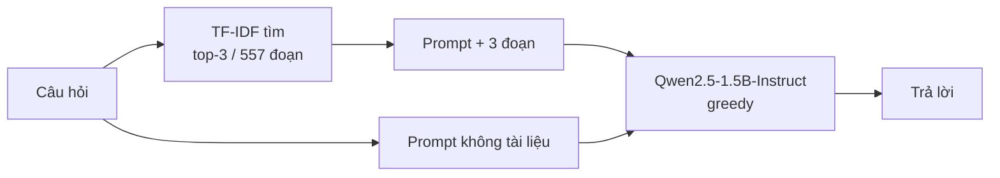

# Mục 8 — Cách thích nghi và bổ sung tri thức: prompting, fine-tuning, RAG

- **Created**: 2026-11-28 (Toàn, AI hỗ trợ, Claude Code). Trạng thái **[đề xuất]**, chờ Toàn duyệt.
- **Nội dung:** bảng so sánh 3 cách, RAG với TF-IDF trên UIT-ViQuAD 2.0, chấm 3 mức (cell 8.1–8.4).
- **Số liệu:** run chính thức `20261128_041850_normal` (Kaggle, GPU T4 x2, float16, seed 42, 22.0 phút, 188 cell; G-Eval chấm 20 lần lấy trung bình). Phần 1–9 và 10.1–10.3b trùng từng file kết quả với run `20261127_234527_normal`, `20261125_214650_normal`, `20261121_010447_normal` (chỉ khác cột thời gian, bộ nhớ); riêng 10.3c, 10.3d đổi theo giám khảo (xem mục 10). **VRAM 6.6, 9.5 lấy run `20261127_234527_normal`**: run chính thức đo lệch +2.97 GiB vì model của lần chạy dừng giữa chừng còn trên GPU. Bảng ở `outputs/results/`, hình ở `outputs/figures/`.
- **Ký hiệu nguồn:** **[Slide ChX]** slide môn học; **[Bổ sung]** nguồn có trong `docs/references.md`; **[Tự tính]** tính lại từ số trong notebook; **[Suy luận]** giải thích của nhóm, chưa đo.
- **Code** chép từ `notebook/llm_presentation.ipynb`; dòng ghi log, gọi `show_input()` và vài dòng in phụ được lược (`# ...`). Mở notebook, tìm số cell (ví dụ "# 4.2") để xem nguyên cell.
- **Bộ đánh giá** (thẻ ở notebook cell 10.5, `figures/suite_*.png`): E7.

---

> **Cô yêu cầu → notebook đáp ứng**
> - Nội dung cần trình bày: *Phân biệt prompting, fine-tuning và RAG*.
> - Yêu cầu minh họa: *Bảng so sánh dữ liệu cần có và trường hợp sử dụng*.
> - Đáp ứng: Bảng so sánh (markdown đầu phần 8 + khối Note); cell 8.1–8.4: demo không RAG so với có RAG trên UIT-ViQuAD 2.0 (góp ý 11/11: mục 8 phải có demo).
> - Góp ý 11/11 và yêu cầu thêm 3: demo trên model thật, output thật, có phân tích.

## Note lý thuyết để hiểu (dùng cho cả phần 8) — bảng so sánh (minh họa của đề)

| Cách | Đổi gì | Dữ liệu cần có | Chi phí | Khi nào dùng |
|---|---|---|---|---|
| **Prompting** (chỉ dẫn, zero/few-shot — phần 7) | Chỉ đổi input | Vài ví dụ hoặc không | Rẻ nhất, tức thì | Tác vụ model đã biết làm |
| **Fine-tuning** (full hoặc LoRA [Bổ sung: Hu et al. 2021]) | **Trọng số** | Tập (input, output) có nhãn; GPU để train | Cao | Đổi hành vi, văn phong, định dạng lâu dài; tác vụ chuyên biệt |
| **RAG** [Bổ sung: Lewis et al. 2020] | Đưa **tài liệu** vào prompt lúc hỏi; trọng số không đổi | Kho tài liệu + bộ tìm kiếm | Trung bình | Tri thức mới, riêng, hay thay đổi; cần dẫn nguồn |

**LoRA (ý tưởng)** [Bổ sung: Hu et al. 2021 §4.1]: giữ nguyên $W_0 \in \mathbb{R}^{d \times k}$, chỉ học phần cập nhật hạng thấp $W_0 + \Delta W = W_0 + BA$, $B \in \mathbb{R}^{d \times r}$, $A \in \mathbb{R}^{r \times k}$, $r \ll \min(d, k)$ → số tham số cần train $r(d + k)$ thay vì $dk$. Notebook **không** fine-tune (góp ý của cô).

**RAG = 2 bước:** (1) **Retrieval**: tìm $k$ đoạn liên quan nhất; (2) **Augmented Generation**: chèn $k$ đoạn vào prompt rồi sinh.

**Hình 5 — Luồng không RAG và có RAG** (ảnh đính kèm đầu phần 8):



Hai nhánh: cùng model, cùng greedy, **cùng câu dặn** "Nếu không biết hoặc tài liệu không có thông tin, trả lời 'Không có thông tin'". Khác **duy nhất**: nhánh trên có 3 đoạn tài liệu.

## Cell 8.1 — Câu hỏi và kho tài liệu (UIT-ViQuAD 2.0)

```python
viquad = pd.read_parquet(VIQUAD_URL)                                     # split validation
corpus = viquad[["title", "context"]].drop_duplicates("context").reset_index(drop=True)   # mỗi đoạn = 1 tài liệu
viquad["gold_doc_id"] = viquad["context"].map(dict(zip(corpus["context"], corpus["doc_id"])))
PRONOUN_RE = r"\b(?:ông ấy|bà ấy|anh ấy|cô ấy|nó|họ|hắn|ông ta|bà ta|người này|nơi này|điều này|việc này|đó)\b"
ok_q = (~viquad["question"].map(lambda q: bool(re.search(PRONOUN_RE, q, flags=re.IGNORECASE)))
        & (viquad["question"].str.split().str.len() >= 7) & ...)
short_ans = viquad["answer_list"].map(lambda a: len(a) > 0 and min(len(x.split()) for x in a) <= 4)
answerable = viquad[ok_q & ~viquad["is_impossible"] & short_ans].sample(N_QA, random_state=SEED)   # 15
impossible = viquad[ok_q & viquad["is_impossible"]].sample(N_QA_IMPOSSIBLE, random_state=SEED)     # 3
```

**Giải thích code:**
- **Kho:** mỗi đoạn `context` khác nhau là một tài liệu → 557 đoạn.
- `gold_doc_id`: đoạn gốc chứa đáp án → dùng đo recall ở cell 8.2.
- **Lọc câu tự đủ nghĩa:** bỏ câu có đại từ ("ông ấy", "nó"…) và câu < 7 từ, vì tách khỏi đoạn văn thì "ông ấy là ai?" vô nghĩa. Đáp án ≤ 4 từ cho dễ chấm.
- **`is_impossible`:** câu mà đoạn văn **không có** đáp án → kiểm xem model có biết từ chối không.

**Output thật:** `UIT-ViQuAD 2.0 validation: 3,814 câu hỏi, 557 đoạn, 19 chủ đề, 1,161 câu không có đáp án` + bảng 18 câu (ví dụ "Muốn ban hành luật thì hoàng đế phải làm gì?", "Bức tranh Mona Lisa nằm ở đâu?"…). Vẫn còn 1 câu có đại từ lọt lưới: "Việc nhịn ăn đối với **ông** là gì?" ("ông" đứng một mình không có trong `PRONOUN_RE`), nhưng có chủ đề "Mahatma Gandhi" đi kèm nên vẫn hiểu được.

## Cell 8.2 — TF-IDF top-3 (bước Retrieval)

> **Lý thuyết ở cell này** [Bổ sung: tài liệu scikit-learn `TfidfVectorizer`]. Mặc định của scikit-learn:
> $$\text{tfidf}(t, d) = \text{tf}(t, d) \times \left[\ln\frac{1 + N}{1 + \text{df}(t)} + 1\right]$$
> $\text{tf}$ = số lần từ/cụm $t$ có trong đoạn $d$; $N = 557$ đoạn; $\text{df}(t)$ = số đoạn chứa $t$. Từ hiếm (df nhỏ) → trọng số lớn; từ phổ biến ("của", "là") → nhỏ. Mỗi vector chuẩn hoá độ dài 1 (L2) nên tích vô hướng = **cosine**: $\cos(q, d) = \dfrac{q \cdot d}{\|q\|\|d\|} = q \cdot d$.
> **recall@k** = tỉ lệ câu hỏi có đoạn gốc trong $k$ đoạn tìm được.

```python
RAG_TOP_K = 3
vectorizer = TfidfVectorizer(ngram_range=(1, 2))
doc_matrix = vectorizer.fit_transform(corpus["title"] + ". " + corpus["context"])  # (số đoạn, số từ/cụm từ)
def retrieve(query: str, k: int = RAG_TOP_K) -> list[int]:
    scores = linear_kernel(vectorizer.transform([query]), doc_matrix)[0]  # vector đã chuẩn hoá → tích vô hướng = cosine
    return scores.argsort()[::-1][:k].tolist()
qa_df["query"] = qa_df["title"] + ": " + qa_df["question"]
qa_df["hit@3"] = [g in top for g, top in zip(qa_df["gold_doc_id"], qa_df["top3_doc_ids"])]
assert retrieve(corpus["title"][0] + ". " + corpus["context"][0])[0] == 0   # tìm chính đoạn 0 phải ra đoạn 0
```

**Giải thích code:**
- `ngram_range=(1, 2)`: đếm cả cụm 2 âm tiết liền nhau ("hoàng đế", "hội đồng") vì tiếng Việt nhiều từ ghép; tách theo dấu cách thì mỗi âm tiết là một "từ".
- `token_pattern` mặc định `(?u)\b\w\w+\b` **bỏ token 1 ký tự** (tài liệu scikit-learn: "words of at least 2 letters"). Với tiếng Việt, âm tiết 1 chữ như "ở", "à", "ý" không được đếm; ảnh hưởng nhỏ vì phần lớn là từ chức năng.
- `fit_transform`: học từ vựng + idf trên kho, biến 557 đoạn thành ma trận thưa.
- `linear_kernel` = tích vô hướng câu hỏi với mọi đoạn = cosine.
- `argsort()[::-1][:k]`: sắp xếp tăng → đảo thành giảm → lấy $k$ đầu.
- Truy vấn = **chủ đề + câu hỏi** (chủ đề giúp tìm đúng bài).

**Output thật:** `Kho: 557 đoạn × 49,750 từ/cụm từ | recall@3 = 0.722 (13/18)`.
**Giải thích:** 5/18 câu không tìm được đoạn gốc trong top-3 (Puerto Rico, Nam Ossetia, Mông Cổ "dưới 30 tuổi" và 2 câu không có đáp án). TF-IDF chỉ so **từ trùng**, không hiểu nghĩa: câu hỏi diễn đạt khác đoạn văn thì trượt. Ảnh hưởng trực tiếp đến cell 8.4.

## Cell 8.3 — Hỏi không RAG và có RAG

```python
REFUSE_RULE = "Nếu không biết hoặc tài liệu không có thông tin, trả lời 'Không có thông tin'."
def prompt_no_rag(r):
    return f"Trả lời ngắn gọn câu hỏi sau (chủ đề: {r.title}). {REFUSE_RULE}\n\nCâu hỏi: {r.question}"
def prompt_rag(r):
    docs = "\n".join(f"[{i + 1}] {corpus['context'][d]}" for i, d in enumerate(r.top3_doc_ids))
    return (f"Dựa vào tài liệu dưới đây, trả lời ngắn gọn câu hỏi (chủ đề: {r.title}). {REFUSE_RULE}\n\n"
            f"Tài liệu:\n{docs}\n\nCâu hỏi: {r.question}")
# ask(): chat template + generate_greedy (cell 5.3), repetition_penalty 1.0, max_new_tokens 48
```
**Giải thích:** hai prompt giống nhau trừ khối "Tài liệu: [1]… [2]… [3]…" → đúng thiết kế một biến. Đánh số [1], [2], [3] để model (và người đọc) biết nguồn.

## Cell 8.4 — Chấm Đúng / Sai / Từ chối

```python
def norm_answer(s):   # chữ thường, dấu câu → khoảng trắng (không xoá), gộp khoảng trắng
    return " ".join(str(s).lower().translate(str.maketrans(string.punctuation, " " * len(string.punctuation))).split())
def judge_qa(output, answers, impossible):
    out = norm_answer(output)
    refused = norm_answer(REFUSE_TEXT) in out
    if impossible: return "Từ chối" if refused else "Sai"
    if any(norm_answer(a) in out for a in answers): return "Đúng"
    return "Từ chối" if refused else "Sai"
```
**Giải thích:** chuẩn hoá theo tinh thần SQuAD [Bổ sung: Rajpurkar 2016] (chữ thường, bỏ dấu câu, gộp khoảng trắng), rồi kiểm output **có chứa** đáp án. Lưu ý: SQuAD gốc chấm **Exact Match** (bằng nhau sau chuẩn hoá) và **F1** theo từ; "có chứa" là biến thể lỏng hơn, hợp với câu trả lời tự do dài hơn đáp án. Dấu câu thành khoảng trắng chứ không xoá: "Charles-de-Gaulle" → "charles de gaulle" khớp "Charles de Gaulle". Toàn đọc lại, sửa 2 câu trong `MANUAL_JUDGE8`.

**Output thật:**
```text
mode                              no_rag  rag
có đáp án                Sai           1    3
                         Từ chối      14    2
                         Đúng          0   10
tài liệu không có đáp án Sai           0    2
                         Từ chối       3    1
Ví dụ: Sân bay nào có số lượng phi cơ ra vào nhiều nhất châu Âu năm 2006? | đáp án ['Charles-de-Gaulle']
  no_rag: 'Không có thông tin.' → Từ chối
  rag   : 'Charles-de-Gaulle' → Đúng
```

**Giải thích từng ô:**
- **Không RAG từ chối 14/15:** câu dặn cho phép từ chối, model 1.5B không chắc nên chọn từ chối. Có cả câu model **biết**: "Mona Lisa nằm ở đâu?" bị từ chối ở đây, nhưng phần 9 (không câu dặn) trả lời đúng "Bảo tàng Louvre" → câu dặn làm model **quá thận trọng**.
- **Không RAG sai 1:** "Muốn ban hành luật thì hoàng đế phải làm gì?" → "phải ký tên vào bản thảo luật" (bịa dù được phép từ chối).
- **Có RAG đúng 10/15:** đáp án nằm sẵn trong đoạn; model chỉ cần **đọc và trích**. [Suy luận] Với model nhỏ, đọc trích dễ hơn nhiều so với nhớ chi tiết hiếm (so 0/15 không RAG).
- **Có RAG sai 3, mỗi câu một nguyên nhân:**
  | Câu | hit@3 | Output | Nguyên nhân |
  |---|---|---|---|
  | Nam Ossetia thuộc chủ quyền nước nào? (Gruzia) | **Không** | "Nam Ossetia thuộc chủ quyền của Nga." | **Retrieval hỏng** → model dùng tri thức sẵn có, sai |
  | Paris lột xác vào lúc nào? (thời Napoléon III) | Có | "…từ thế kỷ 16 đến thế kỷ 17." | Có tài liệu nhưng **đọc sai** |
  | Liên minh các Vương hầu thành lập vì sao? | Có | "…năm 1785 với mục đích bảo vệ… khỏi những tham vọng của Hoàng đế Joseph II." | Đúng ý một phần nhưng không chứa chuỗi đáp án → **giới hạn chấm khớp chuỗi** (§13) |
- **Có RAG từ chối 2** (Puerto Rico, Mông Cổ "dưới 30 tuổi"): cả hai hit@3 = **Không** → không có tài liệu đúng thì RAG không cứu được. **RAG chỉ tốt bằng bộ tìm kiếm.**
- **Câu không có đáp án: có RAG bịa 2/3.** Câu `is_impossible` của UIT-ViQuAD 2.0 có **cùng chủ đề và nhiều từ trùng** với đoạn văn nhưng đoạn không trả lời được (bộ dữ liệu theo kiểu SQuAD 2.0; mức "cố ý gài bẫy" chưa đối chiếu bài báo VLSP 2021, [cần kiểm]). Có đoạn "gần đúng" → model lấy một câu liên quan rồi trả lời tự tin (ví dụ "Khi vùng đất sa mạc bị tàn phá thì dẫn đến điều gì?" → model chép một câu về sa mạc mở rộng). Không RAG thì từ chối cả 3.
- **Nhãn sai của bộ dữ liệu:** "Vua Charles bị xử tử năm nào?" đáp án gốc "1640", nhưng đoạn nguồn chỉ nói "quốc hội năm 1640"; Charles I bị xử tử ngày **30/1/1649** (phiên xử bắt đầu 20/1/1649). Có RAG trả lời "20 tháng 1 năm 1649": **năm đúng, ngày là ngày mở phiên xử** → chấm tay Đúng vì câu hỏi chỉ hỏi năm.

**Kết luận mục 8:** RAG bổ sung tri thức **lúc hỏi**, không đổi trọng số (0 → 10 câu đúng); nhưng phụ thuộc bộ tìm kiếm (recall 0.722) và tài liệu gần đúng có thể gây sai tự tin.

## Câu hỏi tự kiểm

| Câu hỏi | Ý trả lời |
|---|---|
| RAG khác fine-tuning? | RAG không đổi trọng số, đổi tài liệu là đổi tri thức ngay; fine-tuning đổi trọng số, cần dữ liệu nhãn và GPU |
| Sao không fine-tune? | Đề chỉ yêu cầu phân biệt; cô góp ý không cần fine-tune; T4 và thời gian không đủ |
| TF-IDF khác embedding? | TF-IDF khớp chữ; embedding là vector học được, bắt được nghĩa |
| Sao dùng UIT-ViQuAD? | Có sẵn đáp án và đoạn nguồn để kiểm chứng, không phải soạn tay |

---
